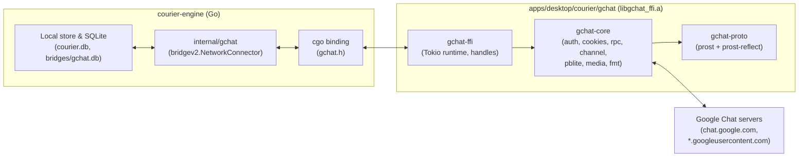

<!--
Copyright 2026 VitruvianSoftware
SPDX-License-Identifier: AGPL-3.0-only
-->

# Courier: Google Chat (Network #6) as a Rust Crate

- **Date:** 2026-10-30
- **Status:** Design spec (scheduled after Milestone 4.6)
- **Scope:** `apps/desktop/courier/gchat` (Rust static library) and `apps/desktop/courier/engine/internal/gchat` (thin Go `bridgev2` connector)
- **Reference:** `Deniel9204/mautrix-googlechat` at commit `5eeada18f6edc8cb125a46870f6e1ce9ff53f22d` (`AGPL-3.0`)
- **Context:** [2026-10-15-courier-iteration-1-design.md](2026-10-15-courier-iteration-1-design.md) (§8, Phase 2.2) and [`apps/desktop/courier/libsignal/README.md`](../../../apps/desktop/courier/libsignal/README.md)

## Fixed decisions

These six decisions are settled and not reopened here:

1. **Own Rust implementation from the community reference.** We write our own Rust implementation using `Deniel9204/mautrix-googlechat` (`5eeada18f6edc8cb125a46870f6e1ce9ff53f22d`, `AGPL-3.0`) as the protocol reference. Because the crate follows that reference closely, it is licensed `AGPL-3.0-only`, matching `apps/desktop/courier/libsignal` and the other bundled bridges.
2. **Rust static library under `apps/desktop/courier/gchat`, thin Go connector via cgo.** Bazel's `rules_rust` compiles `apps/desktop/courier/gchat` from source into `libgchat_ffi.a` (`//apps/desktop/courier/gchat:gchat_ffi`). A thin Go `bridgev2.NetworkConnector` in `apps/desktop/courier/engine/internal/gchat` links it via cgo. Rust owns the protocol, wire codecs, long-polling, formatting, and media transfer; Go only adapts `bridgev2` types and persists state.
3. **Built-in `WKWebView` sign-in.** Sign-in reuses Courier's existing `SignInWindowController` and `CookieCollector` (`apps/desktop/courier/app/Sources/Courier/SignInWindow.swift`) to collect the five required cookies (`COMPASS`, `SSID`, `SID`, `OSID`, `HSID`) from their exact domains. The user never pastes cookies or cURL commands.
4. **Hardened host and logging rules.** Auth cookies are sent and absorbed only on `google.com` and `*.google.com` hosts (never `googleusercontent.com`). Media upload and download hosts are restricted to an explicit Google domain allowlist, closing the reference bridge's open `x-goog-upload-url` follow and unallowlisted redirect hops. There is no telemetry. Cookies and tokens are never logged, and all engine log lines pass through `apps/desktop/courier/engine/internal/logscrub`.
5. **Sequenced after Milestone 4.6.** Build starts after Milestone 4.6 lands. The socket protocol version (`apps/desktop/courier/protocol/protocol.json`) and SQLite schema migration index (`apps/desktop/courier/engine/internal/store/migrate.go`) take the next free numbers at build time.
6. **Synthetic fixtures only.** Automated tests use recorded synthetic fixtures and local mock servers, never a real Google account. Real sign-in and live messaging are verified by hand during the owner's test pass.

---

## 1. Goal and non-goals

**Goal:** Add Google Chat (`gchat`) as Courier's sixth on-device network so a user can sign in once in Courier's built-in browser window and read, search, and send direct messages (DMs), group spaces, threaded replies, quote-replies, edits, unsends, emoji reactions, read receipts, typing indicators, and file attachments up to 200 MB.

**Non-goals:**
- Running a Python bridge or external sidecar process.
- Supporting manual cookie or cURL paste login flows in the UI.
- Implementing features Google Chat's private web protocol or the reference bridge does not support: stickers, location sharing, disappearing messages, polls, user presence/online status, room image avatar uploads, or multi-page history pagination beyond the single-page `list_topics` / `list_messages` window.
- Fetching inline preview images from arbitrary third-party domains by default.

---

## 2. Architecture and the Rust/Go boundary

Google Chat's web client speaks a private Google protocol ("Dynamite") over three transports: an HTML bootstrap page (`/u/0/mole/world`), 19 binary Protobuf RPC endpoints (`/u/0/api/*`), and a streaming HTTP long-poll channel (`/u/0/webchannel/*`) that frames messages in `pblite` (a Google format where a Protobuf message is serialized as a 1-indexed JSON array instead of binary tags).



### 2.1 Split of responsibilities

| Layer | Path | Owns |
|---|---|---|
| **Rust protocol library** | `apps/desktop/courier/gchat` | Cookie jar and `Set-Cookie` rotation, User-Agent normalization, `/u/0/mole/world` XSRF scraping and 24-hour refresh loop, `pblite` JSON-array codec, `/u/0/api/*` binary Protobuf RPC client with base64 fallback, WebChannel 4-step handshake and UTF-16 chunk parser, reconnect and backoff ladders, Scotty two-step media upload, attachment and avatar downloaders, DNS/IP SSRF guard and host allowlists, and Google Chat `Annotation` $\leftrightarrow$ Matrix HTML/plain-text conversion (`gchatfmt` / `matrixfmt`). |
| **Go connector** | `apps/desktop/courier/engine/internal/gchat` | Implementing `bridgev2.NetworkConnector` and `bridgev2.NetworkAPI`, registering the `"cookies"` login flow, storing `UserLoginMetadata` (cookies, user revision cursor, pending invites) and `PortalMetadata` / `MessageMetadata` in `bridges/gchat.db`, translating C ABI events into `bridgev2` remote events (`RemoteEventMessage`, `RemoteEventEdit`, `RemoteEventReaction`, etc.), and handing media bytes to Courier's media store. |
| **Network registry** | `apps/desktop/courier/engine/internal/networks` | Registering `Name: "gchat"`, `DisplayName: "Google Chat"`, `Flows: []string{"cookies"}` on macOS (`darwin`), and listing `{"name": "gchat", "display_name": "Google Chat", "macos_only": true}` in `apps/desktop/courier/protocol/networks.json`. |

### 2.2 Internal Rust layout

Within `apps/desktop/courier/gchat`:
- `proto/googlechat.proto`: The 2,737-line `proto2` schema compiled at build time via `prost` and `prost-reflect` (which supplies runtime field descriptors so `pblite` can map array indices to Protobuf field numbers without custom codegen).
- `src/cookies.rs`: Cookie jar, header serializer, and `google.com` host check.
- `src/auth.rs`: `/u/0/mole/world` scraper, XSRF token state, and auth-error predicates.
- `src/pblite.rs`: Descriptor-driven 1-indexed JSON array $\leftrightarrow$ `prost` message serializer and deserializer.
- `src/rpc.rs`: Typed `/u/0/api/*` caller, `RequestHeader` stamper, base64 wrapper fallback, and HTTP retry policy.
- `src/channel.rs`: WebChannel `/register` and `/events` long-poll state machine, UTF-16 `ChunkParser`, watchdogs, and backoff ladders.
- `src/media.rs`: Scotty 2-step resumable upload, `/api/get_attachment_url` redirect follower, avatar fetcher, host allowlist validator, and SSRF-guarded `reqwest` DNS resolver.
- `src/fmt/`: UTF-16 offset `Annotation` converter between Google Chat text/annotations and Matrix HTML.
- `src/ffi.rs` & `include/gchat.h`: C ABI exports, handle table, and Tokio task dispatch.

### 2.3 C ABI surface (`include/gchat.h`)

All structured requests and responses cross the C boundary as serialized Protobuf byte slices (`GChatBytes`) so cgo never marshals nested C structs.

```c
#include <stdint.h>
#include <stddef.h>

typedef struct GChatClientHandle GChatClientHandle;

typedef enum {
    GCHAT_OK = 0,
    GCHAT_ERR_AUTH = 1,          // Not logged in, HTTP 401 after XSRF retry, or invalid_grant
    GCHAT_ERR_RATE_LIMIT = 2,    // HTTP 429 after retries
    GCHAT_ERR_NETWORK = 3,       // Dial/TLS/read timeout, DNS block, or HTTP 5xx
    GCHAT_ERR_WIRE = 4,          // Protobuf, pblite, or WebChannel chunk parse failure
    GCHAT_ERR_INVALID_ARG = 5,   // Bad parameter, disallowed host, or file too large
} GChatStatus;

typedef struct {
    const uint8_t *ptr;
    size_t len;
} GChatBytes;

typedef enum {
    GCHAT_EVENT_CHAT_PROTO = 1,      // Serialized googlechat.Event (already split per EventBody)
    GCHAT_EVENT_CONNECTED = 2,       // Empty payload; WebChannel SID bound and initial ping sent
    GCHAT_EVENT_DISCONNECTED = 3,    // UTF-8 reason; transient poll drop
    GCHAT_EVENT_AUTH_FAILED = 4,     // UTF-8 reason; permanent credential failure (relogin needed)
    GCHAT_EVENT_FATAL_ERROR = 5,     // UTF-8 reason; 4th consecutive Unknown SID (5m-1h backoff)
    GCHAT_EVENT_COOKIES_UPDATED = 6, // JSON map<string,string> of current cookies after Set-Cookie
} GChatEventType;

typedef void (*GChatEventCallback)(
    uintptr_t go_client_id,
    GChatEventType event_type,
    GChatBytes payload
);

typedef void (*GChatRpcCallback)(
    uintptr_t req_id,
    GChatStatus status,
    GChatBytes response_proto_or_err_utf8
);

GChatClientHandle* gchat_client_new(
    uintptr_t go_client_id,
    GChatBytes cookies_json,
    GChatBytes user_agent_utf8,
    uint8_t allow_external_url_media,
    GChatEventCallback event_cb
);

void gchat_client_connect(GChatClientHandle *client);
void gchat_client_disconnect(GChatClientHandle *client);
void gchat_client_logout(GChatClientHandle *client);
void gchat_client_free(GChatClientHandle *client);

void gchat_client_rpc(
    GChatClientHandle *client,
    uintptr_t req_id,
    const char *endpoint,
    uint8_t idempotent,
    GChatBytes request_proto,
    GChatRpcCallback cb
);

void gchat_client_upload_media(
    GChatClientHandle *client,
    uintptr_t req_id,
    const char *group_id,
    const char *filename,
    const char *mime_type,
    GChatBytes data,
    GChatRpcCallback cb
);

void gchat_client_download_attachment(
    GChatClientHandle *client,
    uintptr_t req_id,
    const char *attachment_token,
    const char *content_type,
    uint64_t max_bytes,
    GChatRpcCallback cb
);

void gchat_client_download_url(
    GChatClientHandle *client,
    uintptr_t req_id,
    const char *url,
    uint8_t is_avatar,
    uint64_t max_bytes,
    GChatRpcCallback cb
);
```

### 2.4 Threading and async model

- **Single shared Tokio runtime:** `gchat-ffi` initializes one process-wide multi-threaded Tokio runtime (`std::sync::OnceLock<tokio::runtime::Runtime>`).
- **Non-blocking FFI calls:** `gchat_client_connect`, `gchat_client_rpc`, `gchat_client_upload_media`, and `gchat_client_download_*` spawn async tasks onto the Tokio runtime and return to Go immediately.
- **Cancellation:** Each `GChatClientHandle` holds a `tokio_util::sync::CancellationToken`. `gchat_client_disconnect` and `gchat_client_logout` trigger the token, aborting the active WebChannel long-poll, the 24-hour XSRF refresh ticker, and any in-flight RPCs.
- **Non-blocking callbacks into Go:** Go passes integer handles (`uintptr_t`, backed by `runtime/cgo.Handle`) for `go_client_id` and `req_id`. For `GChatRpcCallback`, the Go `//export` function copies the result slice, sends it to a 1-buffered Go channel waiting on `req_id`, and returns immediately. For `GChatEventCallback`, the Go `//export` function copies the event slice and pushes it onto an unbounded per-client Go queue worker so Tokio worker threads never block on SQLite writes or `bridgev2` locks.

### 2.5 Memory ownership across FFI

1. **Go $\rightarrow$ Rust inputs are caller-owned:** Every `GChatBytes` or `const char*` passed from Go into a `gchat_client_*` function is borrowed only until that C function returns. Rust copies the bytes into owned Rust types (`Vec<u8>` / `String`) synchronously before spawning any Tokio task, and Go frees its `C.CBytes` / `C.CString` immediately with `defer C.free(...)`.
2. **Rust $\rightarrow$ Go callback payloads are callee-copied:** Every `GChatBytes` passed to `GChatEventCallback` or `GChatRpcCallback` points to memory owned by the Rust stack frame invoking the callback. The Go `//export` trampoline copies the bytes with `C.GoBytes(unsafe.Pointer(b.ptr), C.int(b.len))` before returning; Rust drops its buffer as soon as the callback returns.
3. **Handle teardown:** `gchat_client_free` cancels the `CancellationToken`, awaits task completion on a bounded shutdown timeout, zeros the in-memory cookie jar and tokens, and drops the `Box<GChatClientHandle>`.

---

## 3. Sign-in flow

Google Chat sign-in uses Courier's existing `StepCookies` flow (`apps/desktop/courier/engine/internal/login/steps.go`):

1. **Step definition:** When the user picks Google Chat in **Add a Network** (or clicks **Reconnect** on an expired account banner), the Go connector returns a `bridgev2.LoginStep` of type `LoginStepTypeCookies` with:
   - `URL`: `"https://chat.google.com/"`
   - `WaitForURLPattern`: `^https://chat\.google\.com/`
   - `UserAgent`: `""` (so `SignInPage.userAgent` applies `SignInPage.safariApplicationName` in the `WKWebView`, which Google's sign-in pages accept)
   - Five required `LoginCookieField` entries:
     - `COMPASS` (`Required: true`, `SourceCookie`, `CookieDomain: "chat.google.com"`, `Pattern: ""` — no regex pattern so `bridgev2` never echoes a rejected cookie value into logs or error strings)
     - `OSID` (`Required: true`, `SourceCookie`, `CookieDomain: "chat.google.com"`)
     - `SID` (`Required: true`, `SourceCookie`, `CookieDomain: "google.com"`)
     - `HSID` (`Required: true`, `SourceCookie`, `CookieDomain: "google.com"`)
     - `SSID` (`Required: true`, `SourceCookie`, `CookieDomain: "google.com"`)
2. **Browser capture (`WKWebView`):** `SignInWindowController` opens `https://chat.google.com/` in a non-persistent `WKWebViewDataStore`. Once the user finishes Google sign-in and lands on `chat.google.com`, `CookieCollector.collect` matches `COMPASS` and `OSID` from `chat.google.com` and `SID`, `HSID`, and `SSID` from `.google.com` (`CookieCollector.cookie` matches both exact `google.com` and `.google.com`), closes the window automatically, and submits the map to the engine.
3. **Sanitization and User-Agent normalization:**
   - The engine URL-decodes percent-encoded cookie values (`login.MaybeURLDecodeCookie`), trims whitespace, strips one layer of matching outer `"` or `'` quotes, uppercases the initial cookie names, and verifies all five required cookies are non-empty.
   - Cookie values are formatted as `name=value` sorted lexicographically by name and joined with `"; "`. Values are **never** wrapped in quotes because Google's servers reject quoted cookie values.
   - Requests sent by the Rust client use the default User-Agent `Mozilla/5.0 (Windows NT 10.0; Win64; x64) AppleWebKit/537.36 (KHTML, like Gecko) Chrome/150.0.0.0 Safari/537.36` (or normalize any caller-supplied User-Agent by rewriting `Chrome/\d+\.\d+\.\d+\.\d+` to `Chrome/150.0.0.0` and `Firefox/\d+\.\d+` to `Firefox/152.0`).
4. **XSRF bootstrap (`/u/0/mole/world`):**
   - Rust sends `GET https://chat.google.com/u/0/mole/world` with query parameters:
     - `origin=https://mail.google.com`
     - `shell=9`
     - `hl=en`
     - `wfi=gtn-roster-iframe-id`
     - `hs=["h_hs",null,null,[1,0],null,null,"gmail.pinto-server_20230730.06_p0",1,null,[15,38,36,35,26,30,41,18,24,11,21,14,6],null,null,"3Mu86PSulM4.en..es5",0,null,null,[0]]`
   - Request headers include `authority: chat.google.com` and `refer: https://mail.google.com/` (deliberately spelled `refer` without the final `er`, matching the web client).
   - Rust matches `>window.WIZ_global_data = ({.+?});</script>` in the HTML response, parses the JSON object, checks that `qwAQke` is not `"AccountsSignInUi"`, and extracts the string key `SMqcke` as the `x-framework-xsrf-token`.
5. **Identity check (`get_self_user_status`):**
   - Rust calls `POST https://chat.google.com/u/0/api/get_self_user_status` (`GetSelfUserStatusRequest`) and reads `user_status.user_id.id` (the user's decimal Gaia ID).
   - The Go connector creates (or updates) the `bridgev2.UserLogin` with `UserLoginID(gaiaID)`, persists the cookies and User-Agent in `UserLoginMetadata`, and starts the real-time WebChannel.

---

## 4. Feature list and capability mapping

Every `/u/0/api/{endpoint}` call is a binary Protobuf `POST` with query parameters `c=<counter>`, `rt=b`, `alt=proto`, and `key=<google_web_api_key>` (the public web-client `apiKey` constant from `ref/pkg/gchatmeow/api.go:22-23`; without `key`, `/api/*` returns HTTP 403), headers `Content-Type: application/x-protobuf`, `X-Goog-Encode-Response-If-Executable: base64`, and `x-framework-xsrf-token: <token>`, and `RequestHeader` (`ClientType: WEB (3)`, `ClientVersion: 2440378181258`, `ClientFeatureCapabilities{SpamRoomInvitesLevel: FULLY_SUPPORTED (2)}`) in field `100` (or field `1` on `PaginatedWorldRequest`). Responses are decoded with `prost::Message::decode`, falling back to standard base64 decoding first if the body was base64-encoded by the server.

### 4.1 Capability summary (Courier static & dynamic room features)

| Capability | Support in Courier (`gchat`) | Protocol mechanics & limits |
|---|---|---|
| **List conversations** | Supported (DMs & Spaces) | `POST /u/0/api/paginated_world` with `WorldSectionRequest{PageSize: 999}`, `fetch_options: [EXCLUDE_GROUP_LITE (1)]`, `fetch_from_user_spaces: true`. Drops items where `read_state.blocked == true`, `hide_timestamp > 0`, or `membership_state != MEMBER_JOINED (2)`. Sorted by `sort_timestamp` descending. |
| **Chat & member info** | Supported | `POST /u/0/api/get_group` with `fetch_options: [MEMBERS (0), INCLUDE_DYNAMIC_GROUP_NAME (5)]` and `include_invite_dms: true` (required or DMs return 404; omitting options can 403). `ROLE_OWNER (2)` maps to admin/owner power level (`50`), others to `0`. User profiles fetched via `POST /u/0/api/get_members` (`name`, `email`, `first_name`, `last_name`, `avatar_url`). |
| **Send text** | Supported (capped at **4,096** chars, the reference's own cap; Google's real limit is undocumented) | New top-level topic via `POST /u/0/api/create_topic` (`history_v2: true`, `local_id: "mautrix-googlechat%<rand>"`); thread reply via `POST /u/0/api/create_message`. |
| **Rich text & mentions** | Supported (UTF-16 span annotations) | `Annotation` spans use **UTF-16 code unit** `start_index` and `length`. Native support for bold (`1`), italic (`2`), strikethrough (`3`), inline code (`5`), code blocks (`7`), underline (`8`), RGB font color (`9`, encoded as `(rgb | 0x7F000000) - (1 << 31)`), bulleted lists (`10`/`11`), hyperlinks (`UrlMetadata`), user mentions (`@<name>` with Gaia ID, `MENTION = 1`), and room mentions (`@all`, `MENTION_ALL = 2`). Inbound zero-length Drive, YouTube, and Meet video call annotations append their link to the message body. Inbound `HIDDEN (6)` spans are omitted. Blockquotes (`> `), headings (`### ` + bold), ordered lists (`1. `), and horizontal rules (`---`) fall back to plain-text prefixes; spoilers are stripped to plain text. |
| **Threads** | Supported | Every top-level message creates a `Topic` whose `topic_id == message_id`. Spaces/DMs expose `threadsOnly` (`threaded_group != nil`) and `threadsEnabled` (`flat_threads_enabled \|\| threadsOnly`). Inbound messages set `ThreadRoot = topicID` when `topicID != messageID` or when `threadsOnly` is true. |
| **Quote-replies** | Supported | Populates `MessageInfo.reply_to` (`SendReplyTarget`) with the target's `MessageId` (including `TopicId`) and microsecond `create_time` (required; Google rejects `SendReplyTarget` if `create_time` is `0`). Inbound reads `Message.reply_to.id.message_id`. |
| **Edit message** | Supported (text only) | `POST /u/0/api/edit_message` with `MessageId` (including `TopicId`), `text_body`, `annotations`, and `AcceptFormatAnnotations: true`. Non-text edits are rejected. Deduplicated against `MessageMetadata.LastEditTime`. |
| **Delete / Unsend** | Supported (for everyone) | `POST /u/0/api/delete_message` with full `MessageId`. Maps to Courier's `unsend` / delete for everyone. |
| **Reactions** | Supported (open Unicode list, multiple per message) | `POST /u/0/api/update_reaction` with `ADD (1)` or `REMOVE (2)` and `Emoji{Unicode: bareEmoji}`. Variation selector `U+FE0F` must be stripped before sending (`Google Chat` never uses `U+FE0F` on the wire) and re-added on inbound events. |
| **Read receipts** | Supported | Outbound: `POST /u/0/api/mark_group_readstate` with `GroupId` and microsecond `last_read_time`. Inbound: `GroupViewedEvent` (own user across devices) and `ReadReceiptChangedEvent` (other users). |
| **Typing indicators** | Supported (live, 6s inbound timeout) | Outbound: `POST /u/0/api/set_typing_state` (`TYPING = 1`, `STOPPED = 2`) with `TypingContext{GroupId}`. Inbound: `TypingStateChangedEvent` with a 6-second timeout (`typing.context` carries the group ID because outer `Event.group_id` is empty on typing events). |
| **Attachments (upload & download)** | Supported (up to **200 MB**) | Outbound: images, videos, audio/voice notes, and files (including GIFs) via 2-step Scotty resumable upload (`POST https://chat.google.com/uploads?group_id=<raw_id>` without `key`, then `PUT <x-goog-upload-url>`), producing base64 `UploadMetadata` attached as an `UPLOAD_METADATA (13)` annotation (`ChipRenderType: RENDER`). Can be disabled via `disable_outbound_media`. Inbound: `GET https://chat.google.com/api/get_attachment_url` (`url_type=FIFE_URL&sz=w10000-h10000` for `image/*`, `url_type=DOWNLOAD_URL` for others); `text/html` attachments are ignored. |
| **Start DM** | Supported (by Gaia ID or email) | `POST /u/0/api/create_dm` with `Members: [UserId{Id: gaia}]` or `Invitees: [InviteeInfo{Email: email}]`. (Resolving an email to a Gaia ID requires calling `create_dm`; there is no standalone lookup RPC.) Note: Beeper's static cloud table marked Google Chat as `no new 1:1`, but on-device `create_dm` works by email or Gaia ID and is enabled in Courier. |
| **Create space** | **UNSURE (disabled in UI until verified)** | `POST /u/0/api/create_group` with `SpaceCreationInfo{Name, AttributeCheckerGroupType: FLAT_ROOM (4)}` and 11-char base64url `local_id`, followed by `create_membership` per invitee. The reference (`ref/pkg/gchatmeow/api.go:325`) explicitly notes `CreateGroup` is **not live-verified** and real accounts may get a bare HTTP 400. Kept behind a feature gate until tested by hand. |
| **Space membership & invites** | Supported (with offline caveat) | Invite user or accept own pending invite via `POST /u/0/api/create_membership`. Kick, leave space, or decline invite via `POST /u/0/api/remove_memberships` (always setting `membership_state: MEMBER_INVITED (1)` even when kicking/leaving joined members). **Caveat:** pending space invites arrive only via live `MembershipChangedEvent` on the WebChannel (ignoring `SPAM_INVITE = 2`), never in `paginated_world`. |
| **Leave DM** | Mapped to Hide DM | Google Chat DMs cannot be left; leaving a DM calls `POST /u/0/api/hide_group` with `hide: true`. |
| **Rename space & topic** | Supported (spaces only) | `POST /u/0/api/update_group` with `UpdateMask: NAME (1)` or `SPACE_DETAILS (4)`. Because `SPACE_DETAILS` overwrites both `description` and `guidelines`, changing the topic first calls `get_group` to preserve existing `guidelines` (and refuses the update if `get_group` fails). |
| **Mute / unmute chat** | Supported (permanent mutes only) | `POST /u/0/api/update_group_notification_settings` (`setting_type: 5` for spaces, `4` for DMs; `MUTED = 2`, `UNMUTED = 1`). Timed mutes (`MutedUntil > 0`) are rejected locally because Google Chat has no mute expiry. **Caveat:** mutes changed in another Google Chat client sync only on `paginated_world` resync (`GroupNotificationSettingsUpdatedEvent` is commented out in the proto). |
| **History backfill** | Single page (20 topics / 20 messages) | Top-level: `POST /u/0/api/list_topics` (`page_size_for_topics: 20`), reversed from newest-first and sorted ascending by `(sort_time, topic_id)`. Thread replies: `POST /u/0/api/list_messages` (`page_size: 20`), sorted ascending by `(create_time, message_id)`. Neither RPC has pagination token support in the reference (`HasMore: false`). Backfilled messages omit reactions because `Message.reactions` lacks reactor user IDs. |
| **Bot cards** | Read-only text rendering | Inbound `Attachment` (`JAddOnsContextualAddOn` cards, formatted text, and buttons) on `Message` field 15 are rendered into readable fallback text/links. |
| **Unsupported features** | Not supported | Stickers (`m.sticker`), locations (`m.location`), disappearing messages, polls, user presence/online status (`GetUserPresence` is unused and `UserStatusUpdatedEvent` is ignored), space avatar uploads (space icons are emoji, not images), and deleting a space for everyone. |

---

## 5. Data model and IDs

| Concept | Wire representation (`googlechat.proto`) | Bridge / Database representation (`bridges/gchat.db`) |
|---|---|---|
| **User ID / Login ID** | `UserId{Id: "<gaia_digits>", Type: HUMAN (0) \| BOT (1)}` | Decimal digit string (`'0'..'9'`), used directly as `networkid.UserID` and `networkid.UserLoginID`. Ghost MXIDs become `@gchat_<gaia>:courier.local`. |
| **Space ID** | `GroupId{SpaceId: &SpaceId{SpaceId: "<id>"}}` (field 1) | `networkid.PortalID("space:<id>")` with `Receiver: ""` (shared across logins). |
| **DM ID** | `GroupId{DmId: &DmId{DmId: "<id>"}}` (field 3) | `networkid.PortalID("dm:<id>")` with `Receiver: UserLoginID` (scoped per login). |
| **Topic (Thread) ID** | `TopicId{TopicId: "<id>", GroupId: <GroupId>}` | Stored as `TopicID` inside `MessageMetadata` and `ReactionMetadata`. For the head message that starts a topic (`create_topic`), `message_id == topic_id`. |
| **Message ID** | `MessageId{ParentId: &MessageParentId{TopicId: <TopicId>}, MessageId: "<id>"}` | `networkid.MessageID("<message_id>")`. Because a reply's `message_id` does not contain its parent `topic_id` or `create_time`, `MessageMetadata` stores `TopicID` (`string`), `TimestampMicro` (`int64`), and `LastEditTime` (`int64`). |
| **Message Part IDs** | Single `Message` with text + `[]*Annotation` | Text body part uses `networkid.PartID("")`. Attachments and inline media parts use zero-padded `att_%04d` (fixing the reference's unpadded `att_%d` where `att_10` sorted before `att_9` when a message had $\ge 10$ attachments). |
| **Timestamps** | `int64` signed Unix **microseconds (µs)** on all active fields (`create_time`, `last_edit_time`, `sort_time`, `view_time`, `read_time_micros`, revisions) | Converted via `time.UnixMicro(micros).UTC()`; exact microsecond value preserved in `MessageMetadata.TimestampMicro` for `SendReplyTarget` and `mark_group_readstate`. |
| **Revision cursors** | `Event.user_revision` (field 6) and `Event.group_revision` (field 7), both microsecond timestamps | `UserLoginMetadata.Revision` stores `user_revision` (used exclusively for `catch_up_user`). `PortalMetadata.Revision` stores `group_revision`. The two revision spaces are independent and must never be mixed, or `catch_up_user` will skip events. |

---

## 6. Real-time channel and reconnect

### 6.1 `pblite` codec

WebChannel events and forward-channel pings use `pblite` instead of binary Protobuf:
- **Layout:** A JSON array where 0-based index `i` holds Protobuf field number `i + 1`. High or sparse field numbers are placed in a trailing JSON object `{"<fieldNumber>": <value>}` as the last array element.
- **Encoding (`Marshal`):** Emits a dense JSON array padded with `null` up to the highest set field. `int64`/`uint64`/`sint64`/`fixed64`/`sfixed64` serialize as decimal strings; 32-bit integers, floats, doubles, and enums serialize as JSON numbers; `bytes` serialize as standard base64 strings; nested messages serialize as nested JSON arrays; `map` fields are unsupported.
- **Decoding (`Unmarshal`):** Preserves 64-bit integer precision (never routing 64-bit numbers through `f64`). Reads positional elements `1..N` first, then sorts trailing sparse-object keys ascending by 32-bit field number so `oneof` last-set-wins is deterministic. Caps recursion depth at `MaxDepth = 64` (because `Message.last_reply` is self-referential). Accepts both JSON numbers and numeric strings for integer/float fields, and both booleans and numbers (`!= 0`) for `bool` fields. Unknown fields and type mismatches are silently skipped without failing the message.

### 6.2 Four-step WebChannel lifecycle

Each `Channel` maintains `rid` (initialized to a random integer in `[10000, 99999]`), `sid` (BrowserChannel session ID, initially `""`), `csessionid` (from `COMPASS`), `aid` (last acknowledged server array ID, initially `0`), and `ofs` (forward-channel sequence counter, initially `0`). Lock acquisition is strictly `sendMu -> mu` so `ofs` values reach the wire in order.

1. **Step 1 — Register:** Reset `sid = ""`, `aid = 0`, `ofs = 0`. Send `GET https://chat.google.com/u/0/webchannel/register?ignore_compass_cookie=1` with `Content-Type: application/x-protobuf`. Absorb `Set-Cookie: COMPASS=dynamite-ui=<csessionid>` into the cookie jar and extract `<csessionid>`.
2. **Step 2 — Bind `SID`:** Send `GET https://chat.google.com/u/0/webchannel/events` (`referer: https://chat.google.com/`) with query parameters `VER=8`, `RID=<rid++>`, `t=1`, `zx=<12-char base36 random>`, `CVER=22`, `$req=count=1&ofs=0&req0_data=%5B%5D`, `SID=null`.
3. **Step 3 — Adopt `SID`, Ack, and Initial Ping:** Parse response header `X-HTTP-Initial-Response` (`[[0,["c","<sid>","",8,12]]]`) and extract `res[0][1][1]` as `sid`. Set `aid = 0`, `ofs = 0`. Send an Ack `GET` to `/u/0/webchannel/events?VER=8&RID=rpc&SID=<sid>&AID=0&CI=0&TYPE=xmlhttp&zx=<zx>&t=1` (discarding its body), then immediately `POST` `StreamEventsRequest{PingEvent: {State: ACTIVE (1), ApplicationFocusState: FOCUS_STATE_FOREGROUND (1), ClientInteractiveState: INTERACTIVE (1), ClientNotificationsEnabled: true}}` encoded as `count=1&ofs=0&req0_data=<pblite JSON>` (`Content-Type: application/x-www-form-urlencoded`) to `/u/0/webchannel/events?VER=8&RID=<rid++>&t=1&SID=<sid>&AID=0`. Without this initial `PingEvent`, Google never streams events. Emit `GCHAT_EVENT_CONNECTED` (which triggers cookie persistence in Go).
4. **Step 4 — Long-poll stream & chunk framing:** Loop `GET /u/0/webchannel/events?VER=8&RID=rpc&t=1&zx=<zx>&CI=0&TYPE=xmlhttp&AID=<aid>&SID=<sid>` on `pollClient` (30s dial/TLS timeout, no total request timeout).
   - **UTF-16 chunk framing:** Streamed bytes arrive as `<digits>\n<payload>`, where `<digits>` is the decimal count of **UTF-16 code units** in `<payload>`. `ChunkParser` holds back incomplete trailing UTF-8 byte sequences across TCP reads so split 4-byte emojis (2 UTF-16 code units) never corrupt into `U+FFFD`. If leading bytes before `\n` are non-digits, `ChunkParser` scans forward to the next ASCII digit in a single slice pass to resync.
   - **Event dispatch:** Each `<payload>` is a JSON array `[[array_id, data_array], ...]`. If `data_array[0]` is `"noop"` (server heartbeat every 15–30s), ignore it; otherwise unmarshal `data_array[0]` as `pblite` into `StreamEventsResponse`, split `Event.body` (field 4) and `Event.bodies` (field 8, cloning the outer `Event` header and setting `Type = body.event_type`) into individual `Event` messages, emit each via `GCHAT_EVENT_CHAT_PROTO`, and advance `aid = array_id`.

### 6.3 Watchdogs, reconnect ladders, and missed-event catch-up

| Condition | Detection | Action |
|---|---|---|
| **Clean server poll close (~1h)** | `EOF` on long-poll body | Reset inner `retries = 0` and immediately open the next long-poll GET with the existing `SID` and `AID`. No disconnect event emitted. |
| **Channel lifetime cap (90m)** | `age >= 90m` before starting a long-poll (`ErrChannelLifetimeExpired`) | Reset `resyncCount = 0`, `backoff = 4s`, `fatalBackoff = 5m`, and immediately register a fresh channel without emitting a disconnect event. |
| **Truncated chunk stream** | `UnexpectedEOF` mid-chunk (`ErrSIDExpiring`) | Immediately call `/register`, increment `retries++`, and re-poll without sleeping. |
| **Read-idle timeout (60s)** | No bytes read for `60s` while blocked on `Read` (disarmed while processing chunks) | Abort response body and treat as a transient network error. |
| **Inner poll retry loop** | Transient read/network error during `Channel.Listen` | Emit `GCHAT_EVENT_DISCONNECTED` when a connected poll drops; retry up to `maxRetries = 3` times with exponential backoff `2s`, `4s`, `8s`. |
| **Outer reconnect loop** | Inner loop exhausted or initial connect failed | Sleep `backoff` starting at `4s` and doubling up to `60s`, then re-verify XSRF (`ensureToken`), re-run `Connect`, and run missed-event catch-up. |
| **Unknown SID (`ErrSIDInvalid`)** | HTTP 400 with `"Unknown SID"` in status or body | Resync (re-register and run catch-up) up to `maxSIDInvalidResyncs = 3` consecutive times (doubling `backoff` each time). On the 4th consecutive `ErrSIDInvalid`, emit `GCHAT_EVENT_FATAL_ERROR` (`StateUnknownError` / `gchat-fatal-error`), drop the channel, and enter the fatal backoff ladder (`5m` doubling up to `1h`). |

**Missed-event catch-up on reconnect:** Whenever a channel connects (or resyncs), if `UserLoginMetadata.Revision > 0`, the connector calls `POST /u/0/api/catch_up_user` with `CatchUpRange{FromRevisionTimestamp: cursor}` for up to `catchUpMaxPages = 100` pages while `status == PAGINATED (2)`, dispatching each event and advancing `UserLoginMetadata.Revision` from `evt.user_revision.timestamp`. If no cursor exists yet, or if `catch_up_user` returns `ABORTED_CUTOFF_EXCEEDED (3)`, `ABORTED_CACHE_INVALIDATION (4)`, or `ABORTED_FROM_REVISION_TOO_OLD (5)`, the connector falls back to a full `paginated_world` conversation sync (`syncMaxAttempts = 3`, `500ms` base backoff).

---

## 7. Error handling and session expiry

### 7.1 XSRF refresh and stampede protection

The XSRF token (`SMqcke`) has a 24-hour staleness window (`defaultXSRFRefreshInterval = 24h`) and is refreshed in three places:
1. **Pre-connect (`ensureToken`):** Before opening a WebChannel if `xsrf_token.is_empty()` or `last_refresh.elapsed() >= 24h`.
2. **Background ticker (`xsrfRefreshLoop`):** Every 24 hours while connected. A single auth error in the background ticker logs a warning; `2` consecutive auth errors (`xsrfRefreshAuthFailuresBeforeGivingUp = 2`) emit `GCHAT_EVENT_AUTH_FAILED` and disconnect.
3. **Reactive HTTP 401 retry:** If any `/u/0/api/*` RPC returns HTTP 401, the client refreshes the XSRF token once and retries the RPC once.

Concurrent refreshes serialize on a mutex (`refresh_mu`). If a waiter sees that `xsrf_token` already changed while it was waiting for the lock, it uses the new token without hitting `/u/0/mole/world` again.

### 7.2 Invalid session detection (`IsAuthError`)

An error is treated as a permanent credential failure (`GCHAT_ERR_AUTH` / `GCHAT_EVENT_AUTH_FAILED`) only when:
1. `/u/0/mole/world` returns `WIZ_global_data["qwAQke"] == "AccountsSignInUi"` (`ErrNotLoggedIn`; other HTML/JSON parse errors are treated as transient wire errors, not logout),
2. An `/u/0/api/*` or WebChannel call still returns HTTP 401 after an XSRF refresh, or
3. A JSON error body contains top-level `"error": "invalid_grant"`.

When `GCHAT_EVENT_AUTH_FAILED` fires, the Go connector emits `status.StateBadCredentials` (`error: "gchat-bad-credentials"`, `UserActionRelogin`). Courier shows the per-account **Reconnect** banner while keeping all synced chats and history readable offline.

### 7.3 RPC retry and rate-limit policy

- **Attempts:** Up to `3` attempts (`attempt = 0, 1, 2`) with base backoff `50ms` (`50ms`, then `100ms`).
- **Transport / read errors:** Retried on all requests.
- **HTTP 429 (`TooManyRequests`):** Retried on **both** idempotent and non-idempotent requests (because a 429 is rejected before server processing). Parses `Retry-After` as integer seconds or HTTP-date, clamped to `[0s, 60s]`, and waits `max(backoffDelay, retryAfter)`.
- **HTTP 5xx (`500..599`):** Retried **only** on idempotent RPCs. Non-idempotent RPCs (`create_topic`, `create_message`, `create_dm`, `create_group`) never retry on 5xx so a post-commit server error cannot duplicate a message, DM, or space.
- **Logout (`LogoutRemote`):** Cancels the active WebChannel, clears `UserLoginMetadata.Cookies = nil` in SQLite, sets `loggedOut = true` so in-flight `Connected` or `CookiesUpdated` callbacks cannot re-save cookies, and zeros the in-memory Rust cookie jar and tokens (Google Chat has no server-side session revocation RPC).

---

## 8. Security

This design closes the four security gaps identified in the audit of the reference bridge (`security.md` §§2.2, 3.2, 3.3, 4.1–4.4):

1. **Cookie domain scoping and `google.com` host gating:**
   - Session cookies (`COMPASS`, `SSID`, `SID`, `OSID`, `HSID`, and any rotated cookies) are attached to requests and absorbed from post-redirect `Set-Cookie` headers **only** when the target URL uses `https://` and its host is `"google.com"` or ends with `".google.com"`.
   - `googleusercontent.com` is never treated as a cookie-eligible domain, so attachment and avatar hops to `*.googleusercontent.com` never carry Google authentication cookies.
   - Unlike the reference's flat map where any `*.google.com` response could overwrite any cookie key, the Rust cookie jar tracks domain scoping so only `chat.google.com` can overwrite `COMPASS` and `OSID`.
2. **Explicit host allowlists for uploads, downloads, avatars, and previews:**
   - **Scotty upload step 2 (`x-goog-upload-url`):** Must use `https://` and have a host equal to `chat.google.com`, `*.google.com`, or `*.googleapis.com` before the `PUT` is sent (fixing the reference's unvalidated `x-goog-upload-url` follow).
   - **Attachment download redirects (`/api/get_attachment_url`, up to 10 hops, HTTP `301`/`302`/`307`/`308` only) and avatar downloads (up to 5 hops):** Every hop must use `https://` (preventing cleartext `http://` downgrade on redirects) and its host must match the explicit Google media host allowlist: `chat.google.com`, `*.google.com`, `*.googleusercontent.com`, or `*.ggpht.com`.
   - **Inline external URL media (`UrlMetadata.image_url`):** Disabled by default (`allow_external_url_media = false`). Even when enabled, fetches are restricted to the Google media host allowlist (`*.googleusercontent.com`, `*.ggpht.com`) with `maxExternalMediaPerMessage = 4`, `15s` per-URL timeout, `30s` per-message budget, and `100 MiB` size ceiling, so a third-party URL in a bot card or webhook can never leak the Mac's IP address or message processing timestamp.
3. **Complete IPv4/IPv6 SSRF dial guard with proxy bypass disabled:**
   - All media and download `reqwest` clients disable environment proxies (`no_proxy()`, fixing `DownloadAttachment` honoring `HTTPS_PROXY` in the reference) and enforce a custom `reqwest::dns::Resolve` + socket address check on every hop.
   - The IP guard blocks loopback, RFC 1918 private, link-local, multicast, unspecified, CGNAT (`100.64.0.0/10`), benchmark (`198.18.0.0/15`), and documentation ranges, and unwraps **all** IPv6-embedded IPv4 transition prefixes before checking the inner IPv4 address: IPv4-mapped (`::ffff:0:0/96`), IPv4-compatible (`::/96`), 6to4 (`2002::/16`), well-known NAT64 (`64:ff9b::/96`), RFC 8215 local-use NAT64 (`64:ff9b:1::/48`), Teredo (`2001:0000::/32`), and ISATAP (`*:0000:5efe:*:*` / `*:0200:5efe:*:*`).
4. **Zero telemetry, no wire dumps, and `logscrub` redaction:**
   - No telemetry, analytics, crash reporting, or update checks exist in the crate or connector.
   - The reference's `GCHAT_DEBUG_DUMP` environment variable (which wrote unencrypted wire chunks and messages to disk without rotation) is **omitted entirely**.
   - `pblite` never logs skipped or unknown field values at debug or trace level.
   - `UnexpectedStatusError` strips URL query strings and fragments (`?key=`, `?attachment_token=`, `?compass_cookie=`) at construction time and never includes raw HTTP error response bodies in user-facing error strings.
   - All logs emitted by the Go connector and Rust FFI bridge route through `apps/desktop/courier/engine/internal/logscrub`, which drops any JSON key not on the allowlist and redacts 6+ digit runs (Gaia IDs), email addresses, quoted strings, and URL paths (`[id]`, `[quoted]`, `[path]`).
5. **Parser and span safety:**
   - `normalizeAnnotations` rejects `start_index < 0 || length < 0` upfront in Rust using checked unsigned bounds (closing the reference's `int64` $\rightarrow$ `int32` narrowing overflow on `math.MinInt32`).
   - `ChunkParser` resyncs past corrupted non-digit prefixes in a single slice scan (`O(n)`) rather than shifting `buf = buf[1:]` byte-by-byte (`O(n^2)`).

---

## 9. Build and licensing

- **License (`AGPL-3.0-only`):** Every file under `apps/desktop/courier/gchat` and `apps/desktop/courier/engine/internal/gchat` carries `SPDX-License-Identifier: AGPL-3.0-only` and attributes `Deniel9204/mautrix-googlechat` (`5eeada18f6edc8cb125a46870f6e1ce9ff53f22d`). This matches `apps/desktop/courier/libsignal` (`AGPL-3.0-only`) and Courier's bundled `mautrix-*` bridges.
- **Bazel build (`rules_rust` + `cgo`):**
  - Follows the `apps/desktop/courier/libsignal/BUILD` pattern (`# gazelle:ignore` so Gazelle does not prune the `cc_library` wrapper).
  - `//apps/desktop/courier/gchat:gchat_ffi_rust` (`rust_static_library`, `crate_name = "gchat_ffi"`) compiles `libgchat_ffi.a` from source inside Bazel (no `cargo` invocation or network access during build).
  - `//apps/desktop/courier/gchat:gchat_ffi` (`cc_library`) wraps `:gchat_ffi_rust` for `darwin` (`arm64` and `x86_64`) and is listed in `cdeps` of `//apps/desktop/courier/engine/internal/gchat`.
  - Like Signal (`networks_signal_darwin.go` / `networks_signal_other.go`), Google Chat is registered in `platformNetworks()` on `darwin` so Linux CI lanes that run portable Go tests skip the macOS-only static archive, while `courier-engine-macos` builds and tests it on macOS.
- **Protocol and database migration numbers:** Built after Milestone 4.6 lands. At build time, `apps/desktop/courier/protocol/protocol.json` and `apps/desktop/courier/engine/internal/store/migrate.go` take the next free integer values.

---

## 10. Testing

All automated tests run 100% offline against recorded synthetic fixtures; no test ever contacts `google.com` or uses a real account:

1. **Rust unit and mock-server integration tests (`apps/desktop/courier/gchat`):**
   - **Auth & cookies:** `/u/0/mole/world` HTML fixtures verifying `SMqcke` extraction, `qwAQke == "AccountsSignInUi"` (`GCHAT_ERR_AUTH`) detection, unquoted `Cookie` header serialization, `Set-Cookie` rotation (`GCHAT_EVENT_COOKIES_UPDATED`), and subdomain isolation (`googleusercontent.com` never receives cookies; non-chat subdomains cannot overwrite `COMPASS`/`OSID`).
   - **Binary Protobuf & base64 RPCs:** Deterministic `prost`-encoded `PaginatedWorldResponse`, `GetGroupResponse`, `ListTopicsResponse`, `ListMessagesResponse`, `CatchUpResponse`, and `CreateTopicResponse` served both as raw binary and base64-wrapped (`X-Goog-Encode-Response-If-Executable: base64`), plus HTTP `401` XSRF refresh retry, `429` `Retry-After` backoff, and idempotent-only `503` retry checks.
   - **`pblite` & WebChannel streaming:** Recorded multi-chunk byte streams covering the 4-step `/register` $\rightarrow$ `SID` bind $\rightarrow$ Ack GET $\rightarrow$ `PingEvent` POST handshake, 4-byte UTF-8 emojis (2 UTF-16 code units) split across TCP read boundaries, single-pass recovery from corrupted non-digit chunk headers, `"noop"` heartbeats, `Event.body` / `Event.bodies` splitting across all handled `EventBody` variants, clean EOF re-poll, 60s read-idle timeout, and `Unknown SID` fatal tier transition after 4 consecutive failures.
   - **Formatting & annotations:** Round-trip conversion between Google Chat `text_body` + UTF-16 `Annotation` spans and Matrix HTML (bold, italic, strikethrough, code, RGB `font_color` bit-twiddling, bulleted lists, links, `@user` and `@all` mentions, Drive/YouTube/Meet link appends, and rejection of negative/overflowing `start_index` or `length`).
   - **Media & SSRF guards:** Two-step Scotty upload (`POST /uploads` $\rightarrow$ `PUT`), `/api/get_attachment_url` redirect chain stripping cookies on `*.googleusercontent.com` hops, rejection of untrusted `x-goog-upload-url` or redirect hosts, rejection of `http://` downgrade hops, and DNS/IP rejection of IPv4 loopback/RFC1918/CGNAT and IPv6 loopback, 6to4 (`2002::/16`), NAT64 (`64:ff9b::/96` and `64:ff9b:1::/48`), Teredo (`2001:0000::/32`), and ISATAP addresses.
2. **Fuzz targets:**
   - `fuzz_chunk_parser`: Feeds arbitrary byte slices and split boundaries into `ChunkParser::feed`.
   - `fuzz_pblite_event`: Feeds arbitrary JSON arrays and deeply nested objects into `pblite::unmarshal::<proto::StreamEventsResponse>`.
   - `fuzz_fmt_annotations`: Feeds arbitrary text and `Annotation` spans into the inbound and outbound format converters.
3. **Go engine & cgo link tests (`apps/desktop/courier/engine/internal/networks` & `internal/gchat`):**
   - `gchat_link_test.go` (mirroring `signal_link_test.go`): Calls across cgo into `libgchat_ffi.a` to verify symbol linkage, client creation, local loopback RPC round-trip, callback delivery, and clean teardown.
   - `networks_test.go`: Verifies `"gchat"` is registered on `darwin`, matches `protocol/networks.json`, offers the `"cookies"` login flow with the five domain-scoped cookies, starts offline with zero network calls when no account is linked, and scrubs Gaia IDs, emails, and URLs through `logscrub`.
4. **By-hand verification:** James's manual test day covers signing into a real Google account via Courier's `WKWebView` sign-in window and sending/receiving live DMs, space threads, edits, unsends, reactions, typing indicators, and attachments.

---

## 11. Risks

1. **Undocumented private protocol drift:** Google Chat's `/u/0/api/*` endpoints, `/u/0/mole/world` `WIZ_global_data` keys (`SMqcke`, `qwAQke`), hardcoded `apiKey` / `clientVersion`, and WebChannel `pblite` field numbers are internal to Google's web client and can change without notice. Mitigated by keeping the `.proto` schema and protocol logic isolated in `apps/desktop/courier/gchat` with permissive `pblite` unknown-field skipping.
2. **Single-maintainer reference with unverified edges:** `Deniel9204/mautrix-googlechat` has a single primary author and notes several rough edges in upstream Google Chat: `create_group` (creating a new space) returns HTTP 400 on real accounts (`not live-verified`), `/uploads` has a history of HTTP 500s (`mautrix/googlechat#114`, mitigated by the `disable_outbound_media` config toggle), and pending space invites only arrive over the live WebChannel.
3. **Terms of Service and high-privilege session cookies:** Like Google Messages and Slack cookie flows, an unofficial client using browser session cookies may conflict with Google's Terms of Service, and `SID`, `HSID`, `SSID`, and `OSID` are primary Google account cookies rather than app-scoped OAuth tokens. Mitigated by running 100% on-device on the user's Mac, restricting cookie transmission strictly to `*.google.com`, scrubbing all logs via `logscrub`, and encrypting bridge databases at rest with a Keychain-held key before selling ([2026-10-15-courier-iteration-1-design.md](2026-10-15-courier-iteration-1-design.md) §9).

---

## 12. Rollout milestones

| # | Milestone | Scope | Done when |
|---|---|---|---|
| **1** | **Crate skeleton & auth** | `apps/desktop/courier/gchat` Bazel `rust_static_library` + `cc_library`, `googlechat.proto` compilation, cookie jar, `/u/0/mole/world` XSRF bootstrap, `get_self_user_status`, C ABI lifecycle, Go `bridgev2` `"cookies"` login flow wired to `SignInWindowController`, and `gchat_link_test.go`. | `bazel test //apps/desktop/courier/engine/internal/networks:networks_test` links `libgchat_ffi.a` and completes a synthetic login and XSRF refresh round-trip. |
| **2** | **Read path** | `pblite` codec, WebChannel 4-step handshake and UTF-16 `ChunkParser`, reconnect/backoff ladders, `paginated_world`, `get_group`, `get_members`, `list_topics`, `list_messages`, `catch_up_user`, and inbound event mapping (messages, formatting, threads, quote-replies, edits, unsends, reactions, read receipts, typing, membership changes) into Courier's store. | Synthetic WebChannel streams and backfill fixtures populate DMs, spaces, threads, and reactions in `courier.db`. |
| **3** | **Send path** | Outbound `create_topic`, `create_message`, thread replies, `SendReplyTarget` quote-replies, outbound HTML-to-UTF-16 `Annotation` converter (formatting, links, `@user` and `@all` mentions), `edit_message`, `delete_message`, `update_reaction` (`U+FE0F` stripping), `mark_group_readstate`, and `set_typing_state`. | All outbound message actions pass end-to-end against synthetic RPC fixtures, including `local_id` transaction echo deduplication and non-idempotent 5xx safety. |
| **4** | **Media** | Scotty 2-step resumable upload (`/uploads`), `/api/get_attachment_url` redirect follower, avatar downloader, explicit Google host allowlists, and the IPv4/IPv6 SSRF DNS/dial guard. | Image, video, voice note, file, and avatar transfers pass fixture tests, and all SSRF/redirect/host-allowlist negative tests reject disallowed targets. |
| **5** | **Polish & by-hand verification** | Space rename and topic update (`update_group` preserving `guidelines`), mute/unmute (`update_group_notification_settings`), DM creation (`create_dm`) and hiding (`hide_group`), space invite accept/decline/leave (`create_membership`, `remove_memberships`), `cargo-fuzz` targets, `logscrub` audit, and owner by-hand verification. | All offline tests and fuzzers pass, worktree is clean, and James verifies real Google Chat sign-in and live messaging on his Mac. |
