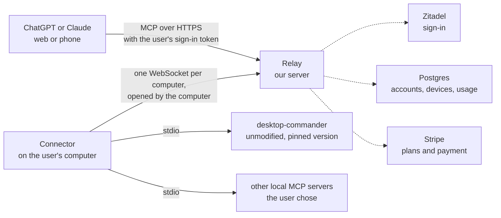

# Vitruvian Relay: a hosted remote MCP for your own computer

> **Name.** "Vitruvian Relay" (`vitruvian-relay`) is the final approved product name.
> The product must not use the name, logo or wording of Desktop Commander (see §9).

## 1. What this is, in one paragraph

Web and phone AI apps (ChatGPT on the web, Claude on the web and on phones) cannot
reach your computer. Desktop AI apps can, because they launch tools on the machine
itself. **Vitruvian Relay** closes that gap as a paid service. A small app on your
computer dials out to our server and stays connected. You add our server to ChatGPT
or Claude as a connector. When the AI wants to run a command or read a file, our
server passes the request down that open connection, your computer runs it, and the
answer comes back the same way. Commands always run on your own machine, under your
own user account. Our server only routes requests.

Desktop Commander already sells this (`mcp.desktopcommander.app`). Its local half is
open source (MIT) and its server is closed. This spec designs our own server and our
own connector from scratch. We read their open-source client to learn what the job
involves, and we copy none of their server, website or branding.

## 2. Fixed decisions

1. **Clean-room server, no reverse engineering of theirs.** Their server code is not
   public, and REA cannot decompile code we do not have. We design our relay from
   our own requirements. Their MIT client is reference reading only (§3).
2. **We don't fork their remote agent.** Our connector is our own code. For the
   actual tools on the machine (terminal, files, search, edit) it runs the
   **unmodified** upstream `@wonderwhy-er/desktop-commander` package as a local
   MCP server over stdio. It does not use that package's `remote` mode. MIT allows
   this. We get their tool improvements for free and we never patch their code.
3. **The connector implements both Desktop Commander and Cua Driver-style GUI automation, plus any other local MCP server.**
   Desktop Commander handles terminal, file, search, and edit tools; Cua Driver-style background GUI automation handles macOS Accessibility-tree inspection, window screenshots, and non-focus-stealing clicks and keystrokes for native desktop apps. The same connector can also expose Courier, Roborock, or any other stdio MCP server the user lists. This sets us apart from the incumbent instead of just cloning it.
4. **The user's machine enforces the rules.** Which tools are exposed, which folders
   are reachable and what needs a local "Allow?" prompt are decided and enforced in
   the connector, not only on the server. A compromised relay must not be able to
   widen what a machine allows (§7).
5. **Billing through the Stripe stack** (`infrastructure/pulumi/platform/stripe`,
   PR #4397) as a second product line beside donations.
6. **Not launched until §9's legal checklist is done.** Building and dogfooding can
   start before that.

## 3. What the upstream client tells us about the job

_From a read of `wonderwhy-er/DesktopCommanderMCP` at commit
`d05721a09d86d35bb86a2b1c07c87139b5d9b6a6` (2026-11-06). Code only; none of their
live servers was contacted._

**How their remote mode works, in brief.** The hosted service is mostly a database
used as a queue:

- **The relay is a handful of HTTPS endpoints:** service discovery, device sign-in
  (start, poll, revoke), feature flags, and enrolment for a message broker.
- **Device sign-in is a standard OAuth device flow with PKCE.** The approved device
  gets a database login session and a device id assigned by the server.
- **A tool call is a row in a database table** (Supabase, a hosted Postgres with
  live updates). The server inserts the row and sends a "new call" wake-up on a
  private per-user channel. The device claims the row with one conditional update
  (pending → executing), runs the tool through a local Desktop Commander process,
  and writes the whole result back to the same row. Their README says finished rows
  are deleted shortly afterwards.
- **There is no streaming.** A call expires about 5 minutes after it is queued if no
  device claims it, and about 30 minutes after a device claims it.
- **Online status is a database column.** The device writes "online, last seen" every
  5 minutes, and the server treats a device as offline after 15 minutes of silence.
- **An MQTT path (AWS IoT) is wired up but inert in this version.** The device
  enrols and subscribes, but its handler for incoming wake-ups is empty. Feature
  flags are fetched and not yet read by anything.
- **The device does not tell the server which tools it has.** The server must keep
  its own fixed tool list.

**What that means for us:**

1. **We won't build a relay for their unmodified client.** Their client can be pointed
   at another server by setting an environment variable. But it would then need
   that server to imitate their sign-in endpoints and Supabase's auth, table and
   realtime APIs exactly. That ties us to their internal interface and to a hosted
   database product, and it keeps the client's local controls as they are. Our own
   connector plus the unmodified local tool package (decision 2) is cleaner.
2. **Their design confirms the job is small.** The work is routing, sign-in, device
   records and metering, not anything clever. Our version uses a direct WebSocket
   in place of a database queue: one fewer moving part, a call reaches the device
   the moment it's sent, and results can stream.
3. **A tool list sent by the device is an improvement.** It lets the user hide tools
   locally and lets one connector bridge several MCP servers (decision 3).
4. **We keep less data.** Their relay holds arguments and results in a table for a
   short time. Ours holds them only in memory while a call is in flight (§7).

_Security note: we read their client with our own security requirements in mind,
and §7 reflects that. Specific weaknesses in a third party's code are not recorded
in this public repo. They go to the maintainer privately first._

## 4. Architecture

The computer always dials out, so it needs no open ports and works behind home
routers and office firewalls. Everything travels over port 443.

### One tool call, start to finish

1. The AI app sends a tool call to the relay's URL for one device, with the user's
   access token.
2. The relay checks the token, checks that the device belongs to that user, checks
   the plan allows another call, and checks the device is online. If any check
   fails, it returns a clear error the AI can show ("Your computer is offline").
3. The relay sends the call down that device's WebSocket with a call id and a
   deadline.
4. The connector checks its **local** rules (§7). If the rules say "ask first", it
   shows a prompt on the computer. It then passes the call to the right local MCP
   server, streams any progress back, and returns the result.
5. The relay returns the result to the AI. It records the tool name, size, duration
   and outcome for the user's activity view and for metering. It does **not** store
   the arguments or the output.

### Decisions in this section

- **One relay URL per device** (`https://<relay>/mcp/d/<device-id>`). A user with
  two computers adds two connectors in ChatGPT or Claude. This is less convenient
  than one URL per account, but the URL plus the token always name exactly one
  machine, so a call can never land on the wrong one. Revisit after alpha (§11).
- **Our own small protocol over a WebSocket**, not MQTT or a hosted realtime
  database like upstream (§3). One connection type and one stateful dependency
  (Postgres) keeps the service small enough to run and reason about.
- **The tool list comes from the device.** On connect, the connector sends the
  tools it allows, already filtered by local rules. When more than one local
  server is bridged, tool names get a server prefix (`dc_read_file`,
  `courier_search`). The relay answers `tools/list` from that and sends
  `notifications/tools/list_changed` when it changes.

### The connector ↔ relay protocol (v1)

JSON frames over `wss://<relay>/connect`. Every frame has a `type`.

| Frame | Direction | Purpose |
|---|---|---|
| `hello` | connector → relay | Device id, connector version, protocol version, signed proof of the device key (§6), the allowed tool list |
| `welcome` / `reject` | relay → connector | Accepted, or refused with a reason the connector can show |
| `call` | relay → connector | Call id, tool name, arguments, deadline |
| `progress` | connector → relay | Streamed output for a running call |
| `result` | connector → relay | Final content or error for a call id |
| `cancel` | relay → connector | The AI gave up or the deadline passed |
| `tools_changed` | connector → relay | New allowed tool list |
| `ping` / `pong` | both | Liveness every 20 s. Three missed pings mark the device offline |

Rules: call ids are unique, and the connector ignores a repeated id for ten
minutes, so a retry never runs a command twice. Frames are capped at 4 MiB, and the
connector truncates bigger outputs with a note saying so. The relay times out a call
at its deadline and sends `cancel`. Reconnects use exponential backoff with jitter,
from 1 s up to 60 s.

## 5. Components

| Component | What it is | Builds on |
|---|---|---|
| **Relay** | Rust service: the MCP endpoint for AI apps, the WebSocket endpoint for connectors, a small web dashboard, the Stripe webhook | The hosted Slack MCP (`apps/mcp/vitruvian-slack-mcp/rs`) already has a Streamable HTTP MCP transport, `/.well-known/oauth-protected-resource` and Zitadel token checks. Pull those out into a shared crate rather than copying them. |
| **Connector** | Rust command-line app, `vrelay` (placeholder): `login`, `run`, `status`, `logout`. Installs itself as a background service: LaunchAgent on macOS, systemd user unit on Linux, scheduled task on Windows | Starts `desktop-commander` (pinned version) and any other configured stdio MCP servers. Later, a menu bar UI on the Vitruvian desktop platform |
| **Dashboard** | Pages served by the relay: sign in, devices (online, last seen, rename, revoke), each device's connector URL and setup steps for ChatGPT and Claude, the activity log, plan and billing | Stripe Customer Portal for payment details and invoices, so we never handle cards |
| **Infra** | Zitadel project and clients, Postgres, DNS, Stripe products | `infrastructure/pulumi/platform/zitadel-apps-*` pattern, the Stripe stack, the hosted Slack MCP's chart and route for the alpha |

macOS comes first, because the connector ships Developer ID-signed and notarised
like the other Mac apps. Linux and Windows follow in phase 3.

The connector needs Node.js 22.12 or newer to run `desktop-commander`, because that
package requires it. In v1 the connector checks for Node and explains how to install
it. Bundling a runtime is an open question (§11).

## 6. Sign-in, devices and billing

**Identity.** Zitadel, in a project of its own, so that an access token for any
other app of ours can never be used at the relay. This is the same reason
`zitadel-apps-mcp-slack` has its own project. Customers sign themselves up into a
customer organisation.

**Connecting a computer.** `vrelay login` uses the OAuth device flow (RFC 8628). The
terminal shows a code, the browser opens, and the user signs in and approves. The
connector then creates a key pair for this computer and registers the public half
with the relay. Every later `hello` proves it holds the private half. Revoking a
device in the dashboard deletes its key, and the next connect is refused.

**Connecting an AI app.** ChatGPT or Claude acts as an OAuth client against Zitadel,
and the relay is the resource server. This is the same arrangement as the hosted
Slack MCP with Gemini Spark. What P0 research found (details in
[the P0 plan](../plans/2026-11-09-relay-p0-spikes.md)):

- **Claude** works with a client we register ourselves, on every plan. That's the
  `relay-claude` client.
- **ChatGPT** gives each connector its own callback URL, so one pre-registered
  client can't serve many users. For a product, ChatGPT needs Zitadel's dynamic
  client registration. Zitadel supports it, but it's off on our instance, and
  turning it on in its open form lets anyone create clients. That's an open
  decision (§11).
- **The relay authorises on client id and subject, never on audience alone.** In
  our Zitadel, any signed-in user can put any project in a token's audience.

**Billing.** A second product line in the Stripe stack: a free tier with a monthly
call allowance and one device, and a paid tier with a much larger allowance and
several devices. Prices are open (§11) and are set without copying the incumbent's.
Stripe Checkout handles sign-up and the Customer Portal handles changes. The webhook
updates an entitlements table, and the relay checks it on every call. Usage is
counted in Postgres. Everything stays in Stripe's sandbox until launch.

## 7. Security

**Be plain about what this is: we are selling remote command execution on
customers' computers.** Whoever controls the relay can send commands to every
connected computer, within what each computer allows. The design starts from that.

1. **The computer has the last word.** The connector enforces, locally:
   - which tools are exposed at all;
   - which folders file tools may touch. A terminal command can still reach
     anything the user can, so folder limits don't contain it. That is why
     terminal commands ask first by default;
   - which tools need a local "Allow?" prompt. The default is: terminal commands and
     any write ask first, reads don't;
   - a one-click pause.

   **No remote call can loosen these rules.** Any tool in a bridged server that
   changes that server's own settings (for Desktop Commander, `set_config_value`
   and similar) is hidden from remote callers by default, because otherwise one
   call could switch off the local limits. The relay cannot change the rules either. They live in a file on the computer and in
   the connector's settings screen.
2. **The relay keeps no content.** Arguments and outputs exist only in memory while a
   call is in flight. The activity log stores tool name, size, duration and outcome.
3. **The computer shows what ran.** The connector keeps its own local log of every
   call with full arguments, which only the user can see, and can post a
   notification per call.
4. **Tenant isolation is tested, not assumed.** An automated test proves user A's
   token cannot list, call or even detect user B's device. It runs in CI on every
   relay change.
5. **Pinned upstream code.** Desktop Commander's own setup runs `@latest`. If their
   npm package were ever compromised, every one of our customers would run the bad
   version on the next restart. The connector pins an exact version with an
   integrity hash, and we bump it by reviewed PR.
6. **Prompt injection is real and can't be fully fixed.** A web page or file the AI
   reads can tell it to run a command. The local rules and "ask first" prompts are
   the defence, and onboarding has to say so in plain words.
7. **Short-lived tokens, device keys, rate limits** per user and per device, and no
   open ports on the user's machine.

## 8. Hosting and cost

| Stage | Where | Why |
|---|---|---|
| Alpha (James, then a few invitees) | Homelab k3s behind the Cloudflare Tunnel, Postgres on CNPG, the same pattern as the hosted Slack MCP | No new cost. Fine for dogfooding |
| Paid launch | GCP through the OSS application stage: Cloud Run plus Cloud SQL Postgres | Homelab availability (Wi-Fi nodes, a single database instance) is not good enough for people paying us |

**Domains (decided 2026-11-09).** The spikes and the alpha run under `ipv1337.dev`
(`relay-spike.ipv1337.dev`). **Production runs under `vitruviansoftware.dev`**, the
zone for commercial products (`docs/engineering/domain-zone-conventions.md`). The
relay URL, the dashboard and the connector's download page all move there. Two
consequences to plan for:

- The resource URL is baked into the protected-resource metadata and into each
  AI app's connector, so moving domains means every alpha user re-adds their
  connector. Do the move before inviting anyone outside the team.
- Sign-in runs on `auth.ipv1337.dev` today, and the domain convention keeps Zitadel
  on `ipv1337.dev` as platform infrastructure. Paying users would see that
  name on the sign-in page. Whether production sign-in gets a
  `vitruviansoftware.dev` name is open (§11).

Two things to know about the paid setup:

- Cloud Run ends a WebSocket after at most 60 minutes. The connector therefore
  reconnects on its own about every 50 minutes, with jitter, and the user notices
  nothing.
- With several relay instances, a computer is connected to one instance but a call
  can arrive at another. Cloud Run instances can't be addressed one by one, and
  Postgres `NOTIFY` messages are capped at 8,000 bytes, too small for results. So
  **launch runs a single relay instance** (Cloud Run max instances = 1, which
  restarts quickly). Scaling out later needs a message bus between instances,
  such as Redis or NATS, which is an added cost. That decision waits until one
  instance is actually too small (§11).

**Zitadel is a launch dependency.** It runs on the homelab today, so a homelab
outage would also be a sign-in outage for paying users. Launch needs Zitadel on
reliable hosting (Zitadel Cloud or our own GKE). That is a cost decision for James
(§11).

I have no measured running costs. They get estimated in phase 3 from alpha usage,
not guessed here.

## 9. Legal and naming

Before taking money, all of these must be done:

- [ ] Read desktopcommander.app's Terms of Service and check nothing in them
      restricts what we built or how we studied it. **Not yet read.**
- [ ] Name, domain and marketing contain no "Desktop Commander". Saying factually
      that the connector "runs the open-source desktop-commander package" is
      probably fine, but confirm with a lawyer.
- [ ] Ship upstream's MIT license notice with the connector.
- [ ] Clean-room record: nobody on the project inspects their hosted service's
      traffic, APIs or pages for this work. Ordinary use as a customer is not
      study. Nothing from their website, UI or docs is copied. Their
      MIT client is read as reference only, and §3 paraphrases behaviour.
- [ ] Our own Terms of Service, privacy policy and acceptable-use policy that address
      remote execution and its liability.
- [ ] A lawyer reviews the above.

Business note: the MIT license allows a competing paid relay. It is still the
author's only paid product built on his own free project, so expect it to cost some
goodwill in that community. Decision 3 (bridge any local MCP server) gives us our
own reason to exist beyond being a cheaper copy.

## 10. Phases

Each phase gets its own plan in `docs/superpowers/plans/`.

| Phase | Scope | Done when |
|---|---|---|
| **P0 spikes** | (a) ChatGPT web and Claude web each add an OAuth-protected MCP on our domain with Zitadel sign-in. Settles the registration question. (b) Zitadel device flow from a CLI. (c) A WebSocket through the Cloudflare Tunnel stays up for 24 hours with reconnects. (d) A connector drives unmodified `desktop-commander` over stdio | Each spike has a written yes or no with evidence |
| **P1 single-user alpha** | Relay and connector on the homelab, one user, one device, local rules file, no billing | James runs a command on his Mac from Claude on his phone, and the "ask first" prompt appears on the Mac |
| **P2 multi-user** | Sign-up, several devices, dashboard, local settings screen, both activity logs, the isolation test in CI | A second invited user connects, and the isolation test fails against a deliberately broken check |
| **P3 launch readiness** | Stripe product line and entitlements, §9 checklist, move to GCP, Zitadel hosting, signed installers for macOS then Linux and Windows, and Cua Driver-style background GUI automation alongside Desktop Commander | A stranger can sign up, pay in Stripe test mode, connect without help, and drive both terminal/file tools (Desktop Commander) and native desktop app UIs in the background (Cua Driver features) |

## 11. Open questions

1. **CLI name.** "Vitruvian Relay" (`vitruvian-relay`) is final; `vrelay` remains a
   placeholder for the CLI binary. The domain is decided: production on
   `vitruviansoftware.dev` (§8).
2. **Sign-in domain for production.** Keep `auth.ipv1337.dev`, or give Zitadel a
   `vitruviansoftware.dev` name for this product. That changes the issuer every
   token carries, so it happens before launch, not after.
3. **Which ChatGPT plans can add a custom MCP server.** Not confirmed. Some
   sources say only Business, Enterprise and Edu workspaces can, which would shrink
   the ChatGPT market a lot. Claude allows it on every plan.
4. **Where Zitadel runs for a paid product**, and whether that cost is worth it now
   or only at launch.
5. **Pricing** for the free and paid tiers.
6. **Node.js**: keep requiring it, or bundle a runtime with the connector.
7. **One URL per device or one per account**, after seeing how alpha users find it.
8. **Open client registration for ChatGPT**: turn on Zitadel's open dynamic
   client registration (and live with anyone being able to create clients), put
   a gate in front of it, or support Claude only at first.
9. **Scaling past one relay instance**: which message bus, and when.
10. **Positioning**: a direct alternative to Desktop Commander's hosted service, or
   "reach any local MCP server from any AI app" with Desktop Commander as one
   option. The spec assumes the second.
