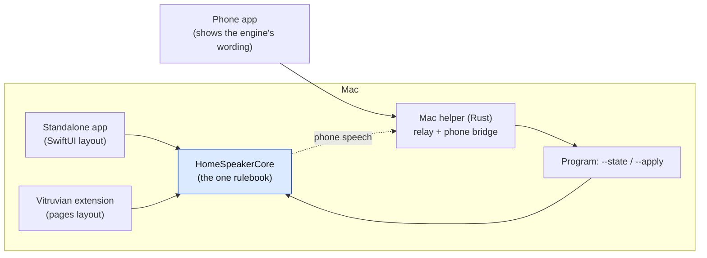

# Home Speaker: one rulebook for the app, the extension and the remote

**Status:** decided 2026-11-10 by James's stand-in (Fable), on James's instruction to "tackle Home Speaker next"
and to brainstorm with Fable in his place. Plan: `docs/superpowers/plans/2026-11-10-homespeaker-one-rulebook.md`.
**Checked against:** `origin/main` at `677e0fa67` (home-speaker 1.38.0, android-remote 0.1.29).

## The verdict

Home Speaker already shares its engine (`HomeSpeakerCore`) between the standalone app and the Vitruvian
extension. The rules that are still written more than once live in three places: the app's screens, the
extension's action handlers, and above all the Android remote, whose Mac helper
(`apps/mobile/android-remote/macagent/rs/src/homespeaker.rs`, 6,296 lines of Rust) and phone app
(`…/remote/state/Derive.kt`, 2,019 lines of Kotlin) read and rewrite Home Speaker's files themselves.
Those copies have drifted from the engine.

We fix it in three moves, in this order:

1. **One rulebook in the engine.** Every rule the app's screens and the extension's handlers carry today
   (choices and their wording, limits, what is shown when, removing a speaker, switching between the app
   and the extension, saving the sign-in client, clearing a chat token) moves into `HomeSpeakerCore`.
   Both front ends call it. Their layouts stay separate: one is SwiftUI, the other is pages Vitruvian draws.
2. **The remote asks Home Speaker.** Home Speaker's program answers `--state --json` (everything a screen
   needs, wording included) and `--apply --json` (changes, checked and written by the engine). The Mac
   helper relays those instead of re-implementing them; the phone shows the wording it is given.
3. **Shared test cases guard the rest.** JSON cases in `apps/desktop/home-speaker/testdata/` are read by
   the engine's tests and by the remote's tests. Each case is added before its fix, so it is seen failing.

Not doing: shared native screens (a `HomeSpeakerUI` library, as Nexus Agent has). Nexus shared screens
because both apps drew the same SwiftUI; Home Speaker's extension deliberately looks like the rest of
Vitruvian. If a page ever needs a control it cannot draw (a slider, a time picker), the fix is to add that
control to Vitruvian's page protocol so every extension gets it.

Blue is the only place a rule lives.

## 1. What was found (verified on `677e0fa67`)

- **Wording differs.** Engine (`HomeSpeakerCore/Models.swift:119-122`): "As written / Plain summary / Status
  update / Conversational". Phone (`Derive.kt:420-424`): "Verbatim / Plain spoken / Warm briefing / Casual".
  Engine "Apple (On-device) / Gemini" (`Models.swift:143-144`) vs phone "Apple (on Mac) / Gemini Flash"
  (`Derive.kt:433-434`). Engine "Direct messages and mentions / Every message" (`Models.swift:800-801`) vs
  phone "Direct & mentions / All messages" (`Derive.kt:837-838`).
- **Removing the default speaker.** The engine picks the next speaker by name (`Models.swift:694-700`); the
  helper leaves no default at all (`homespeaker.rs:3832-3845`).
- **Chat monitor status.** The engine believes a status file only while its owner runs
  (`ChatMonitorStatus.believed(ownerRunning:)`); the helper reports it straight from the file
  (`homespeaker.rs:3042-3043`), so a crash can leave the phone saying "running".
- **The app↔extension switch exists three times:** the app (`AppSwitch.swift`), the extension
  (`HomeSpeakerTool.swift` around 1476-1503) and the helper, which writes the choice file and re-points the
  coding-agent hooks itself (`homespeaker.rs:1695-1751`, `:3090`).
- **The engine needs the helper.** Speaking on the phone posts to the helper
  (`PhoneSpeaker.swift`, `http://127.0.0.1:7411/v1/homespeaker/phone-say`). So the helper stays a real
  service (phone bridge, phone HTTP API, clipboard speech); only its copy of Home Speaker's rules goes.
- **A machine contract already exists in small.** `--volume`, `--set-volume`, `--mute`, `--unmute` print JSON
  "the contract the Mac agent relies on" (`CommandLine.swift:681-725`), and the extension's `bin/tool`
  takes the same flags. This design finishes that contract rather than inventing a new channel.
- Reported by a Gemini read and not re-checked by the lead (each becomes a shared case, which settles it):
  quiet hours off the half-hour grid (prepended vs sorted), 0% offered for announce volume in the
  extension but not the phone, the helper's reset keeping different keys, the sign-in client's secret kept
  or dropped differently on save.

## 2. The rulebook in the engine

A new file group in `HomeSpeakerCore` (names indicative; the plan fixes them):

- **`SettingsCatalog`**: for every setting a screen shows, its key, its label, its kind (toggle, choice,
  number, text, time), its choices with their labels, its limits and step, and whether it is shown given the
  rest of the settings. Built from the existing enums and `SpeakerConfig` rules (`SpeechLength.label`,
  `showsHomeControls`, …), which stay the single source. Adds what is missing in the engine today
  (for example a label for `GoogleChatSource`, and the half-hour time choices).
- **`SettingsActions`**: plain functions that change settings or secrets and return what changed and any
  warning: set a value (checked and clamped), remove a speaker, save the sign-in client, clear a chat
  token, switch to the app or the extension (choice file, hook re-pointing, quitting the other one), reset.
  Written under the engine's existing locks (`SpeakerConfigFile`, `SecretStore`, the door's lock).
- The app's `SettingsView`/`MenuBarView` and the extension's `HomeSpeakerTool`/`Pages` are changed to call
  these and to carry no rules of their own. Their look does not change, except where the engine's wording
  is changed on purpose (below).

**Wording rule.** Where the copies disagree, the engine's wording wins, because the app and the extension
already show it. Two exceptions:
- The phone calls itself "This phone" where the Mac says "Your phone". That is a point of view, not drift:
  the contract carries the engine's wording and one documented substitution on the phone, covered by a
  shared case.
- Where the engine's own label is ambiguous when read on the phone ("Apple (On-device)": the phone has an
  on-device voice too), the engine's label is fixed, to "Apple (on this Mac)". The app and the extension
  change with it.

## 3. The program's contract

Both programs (the app's `HomeSpeaker` and the extension's `bin/tool`) gain:

- **`--state --json`**: one JSON document: contract version, Home Speaker version, which one is chosen
  (app or extension) and whether it is running, the settings catalog filled in with current values and
  visibility, speakers in the engine's order and wording, sign-in and chat states, the chat monitor status
  as the engine believes it, coding-agent hook states, the "speaks on" summary, and warnings. Read-only:
  either program answers, chosen or not.
- **`--apply --json '<changes>'`**: a list of operations (`set`, `removeSpeaker`, `switchTo`, `reset`, and
  the few actions the phone already offers). Checked and written by `SettingsActions`; answers with the new
  state, or with a JSON error naming the problem. Run on the program that is NOT the chosen one, it refuses
  and names the chosen program, so a stale caller corrects itself.
- Failures are JSON and exit non-zero, as `--volume` does today. Unknown keys in the settings file are kept,
  as today.
- A running app or extension sees an external change within seconds (the app already watches its settings
  file; the extension's watch is checked and added if missing).

## 4. The remote

- **Mac helper.** Keeps: pairing, the phone bridge and `phone-say`, its HTTP API, clipboard speech,
  version reporting, and about 30 lines that read the choice file to find which program to run (the same
  rule the hook uses, `homespeaker.rs:2067-2090`). Replaces its reads and writes of Home Speaker's settings,
  secrets, history and status files, its door writing and its hook re-pointing with calls to the chosen
  program's `--state` / `--apply`. Its `/v1/homespeaker…` endpoints keep their paths; their bodies become
  the program's answers. It runs `--version` once and, below the minimum, says "Update Home Speaker on
  <Mac> (have X, need Y)".
- **Phone app.** Shows labels, choices and limits from the payload, deleting its own copies. Not installed
  or too old: one plain sentence, not a half-working settings screen.
- **Home Speaker not installed:** the remote says so. There is no fallback path that edits the files
  directly (decided: nothing can speak without Home Speaker anyway).

## 5. Releases and compatibility

Release-scope requires one product per pull request. Order: home-speaker (rulebook, then contract) →
android-remote helper → android-remote phone. Each tolerates the older piece below it: an older helper
ignores new flags; a new helper on an older Home Speaker shows the "update" sentence. No second code path
is kept for old versions: backward-safe (nothing fails silently), not backward-compatible. James is the
only user today, and the message is what a public product owes.

## 6. Acceptance criteria (what James sees)

1. Every label, option list and limit on the phone is word for word what the Mac app and the Vitruvian
   extension show; a shared test case fails if any differ.
2. Removing the default speaker on the phone picks the next speaker, as the Mac does.
3. A change on the phone appears in the running app or extension within seconds, and the other way round,
   with no lost edit when both write at once.
4. Switching between the app and the extension from the phone re-points the Claude Code, Antigravity and
   OpenCode hooks exactly as switching on the Mac does; `speaker-broadcast` keeps working afterwards.
5. Home Speaker missing or too old: one plain sentence on the phone.
6. The chat monitor shows "stopped" on the phone when its owner is not running, even if a crash left the
   file saying "running".
7. Speech on the phone from the Mac still works; `--say`, `--volume`, the hooks and `speaker-broadcast`
   are unchanged.
8. The payoff: adding a setting to the engine needs no Rust change and at most a wiring line of Kotlin; the
   guide's parity checklist rows for the helper and the phone become "the shared cases pass".

## 7. Risks

- **Running the real program in tests.** Running a built Home Speaker with an argument it does not
  understand starts the menu bar app, which re-points James's live Claude Code hook. Every task tests the
  CLI through its functions, or with a scratch `HOME` and `CFFIXED_USER_HOME` and process-level actions
  (quit, open) neutralised. A scratch home hides files, not running apps.
- **Main-thread entry points.** Headless entries that touch the main actor must keep the main thread running
  its loop, never `dispatchMain()` (Home Speaker 1.19.0 crash-looped on this).
- **The helper is a phone-facing API.** Its paths and the meaning of its fields stay; a field that disappears
  is a phone change in the same release train.
- **Process per request** costs tens of milliseconds per phone action; acceptable for settings screens, and
  the speaking and volume paths already work this way.
