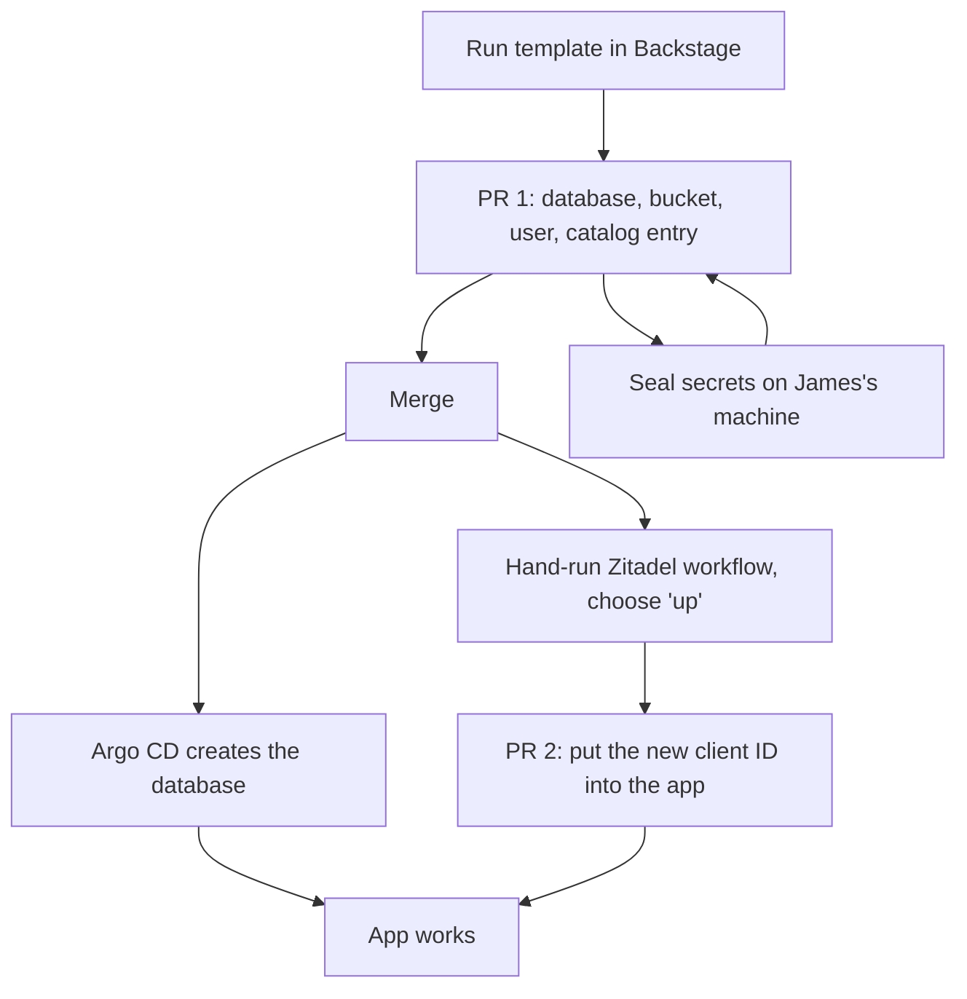

> **RFC, open for feedback.** Came out of a brainstorm and two six-reviewer Goldfish rounds. Next step after feedback: a formal design.

# Concept Brief: A Supabase-style console built on what we already run

**Author:** James (Vitruvian Software)
**Date:** 2026-11-12

Revision 3. Revision 2 went through the six-lens review. All six reviewers finished; their
status is in the table at the end. This revision fixes the facts they disproved and changes
the plan to match.

## Overview

James wants two things from Supabase without running Supabase:

- **one screen** that shows the state of everything an app uses, and
- **one step** to give a new app its backend (database, sign-in, file storage, secrets).

The concept is to use Backstage, the developer portal we already run, as that screen. Each
first-party app gets a page that shows, or links straight to, its pods, deploys, database,
sign-in project, file bucket, dashboards, alerts and logs.

The review changed the plan in three ways:

1. **The "one step" is really several steps today.** The sign-in part (Zitadel) is applied
   by a hand-started workflow, and secrets can't be sealed from inside Backstage. A new
   backend takes at least two pull requests plus manual work until that changes.
2. **Nobody needs a new backend yet.** No first-party app runs a database on the homelab
   today. Relay is the only planned one. Where Relay's database lives at paid launch is
   undecided: the design doc says Cloud SQL, but James says that may cost more than we want
   to pay, so Relay may stay on homelab CNPG with paying users. That makes the database
   alerts and restore test more urgent, not less. The backend template and the database
   viewer still wait for a second app.
3. **Backstage had a security hole.** Two scorecard endpoints answered requests from anyone
   on the internet without sign-in. The fix is in PR #4655 (in the merge queue, not yet
   merged on 2026-11-12). Nothing that touches data goes near Backstage until it lands.

What each Supabase screen maps to, and what is true today:

| Supabase screen | Our version | State today (checked in the repo) |
| --- | --- | --- |
| Project overview: health, deploys | Backstage app page: Kubernetes, Argo CD and Prometheus tabs, plus a Grafana dashboards card | **Partial.** The tabs exist (`apps/web/backstage/packages/app/src/components/catalog/EntityPage.tsx:262-304`) but each one only appears if the app's catalog entry has the right annotation. Only the Slack MCP has the Kubernetes and Argo CD annotations (`apps/mcp/vitruvian-slack-mcp/catalog-info.yaml:41-44`). There is no Grafana tab, only a card on the overview (`EntityPage.tsx:178-191`). |
| What the app uses | Backstage dependency graph from each app's `dependsOn` list | **Gap.** No catalog entry exists for any single database or bucket. Tabs lists `monorepo-tooling` and `zitadel` (`apps/suites/vitruvian-tabs/catalog-info.yaml:78-80`). Relay has no catalog entry for the app at all. |
| Users and sign-in settings | Zitadel console, one project per app | **Have it**, as a link out |
| File buckets | MinIO console | **Have it**, as a link out |
| Database health and backups | Database status on the app page | **Gap.** Backstage has no permission to read CNPG objects (`gitops/argocd/platform/backstage/rbac.yaml:43-83`). A CNPG Grafana dashboard exists (`gitops/argocd/platform/grafana-dashboards/cnpg.json`). |
| Browse tables, run SQL | Read-only database access | **Gap.** Deferred (see Phase 3) |
| Logs | Grafana with a log store | **Gap, larger than revision 2 said.** There is no log store and no log collection at all. |
| "New project" button | A backend option in the existing app initializer | **Gap.** The initializer already has a Postgres-on-CNPG option, but nothing generates files for it (`tools/initializer/config.json`). |

Words used below:

- **CNPG** (CloudNativePG): the operator that runs Postgres clusters inside Kubernetes.
- **`dependsOn`**: the list in an app's Backstage catalog entry of what the app relies on.
- **SealedSecret**: a secret encrypted so it can live in git; only the cluster can decrypt it.
- **Scaffolder**: Backstage's template runner. It fills in files and opens a pull request.
- **Zitadel**: our sign-in service. **MinIO**: our in-cluster file storage.
- **PostgREST**: a server that turns Postgres tables into a web API.

## Analysis

### 1. How a new backend would actually be created today

Revision 2 promised one pull request. These steps stop that:

- **Zitadel is not applied on merge.** Each app has its own Pulumi program and its own
  workflow, started by hand and defaulting to a dry run
  (`.github/workflows/zitadel-apps-relay-apply.yaml:35-43`). That also breaks the repo rule
  that the pipeline is the only trigger (`AGENTS.md`, "Orient first"). The app's client ID
  only exists after the apply, so a second pull request has to wire it in.
- **Backstage can't seal secrets.** Sealing runs `kubeseal` on an operator's machine
  against the live cluster (`tools/gitops/src/ops/common.rs:228-260`). Doing it inside
  Backstage would put plain passwords in the Backstage server and maybe its task logs.
- **MinIO users live in one shared file.** All buckets, policies and users sit inside one
  Helm values block (`gitops/argocd/platform/minio-amd64/applicationset.yaml:92-142`,
  `185-229`, `362-414`). Changing a password or removing a user needs a hand-run `mc admin`
  command (lines 182-184). Two template runs at once would conflict.
- **The current render action only writes new folders.** It refuses a path that exists
  (`apps/web/backstage/packages/backend/src/scaffolder/appRender.ts:569-580`), so it can't
  edit the shared files above.
- **Reverting the pull request deletes the database.** Argo CD prunes, and CNPG owns its
  disks (`gitops/argocd/platform/zitadel-db/applicationset.yaml:40-44`, `205-208`).

What would make "one step" true, all of which come before any template:

- One Zitadel Pulumi program for the homelab that reads one small file per app, previews
  on the pull request and applies on merge.
- Let CNPG generate the database password itself, so that secret never needs sealing.
- Generate and seal MinIO credentials in a CI job, never in Backstage.
- A way to add a MinIO user by adding a file, not by editing the shared block.
- A delete guard on generated databases.

### 2. Is there anyone for this to serve yet?

- Seven CNPG clusters exist. All belong to platform or third-party apps: `cnpg-cluster`,
  Grafana, Zitadel, Backstage, Buzz, Umami, Sentry. None belongs to a first-party app.
- Tabs runs on Cloud Run and Neon, and moving it is a non-goal.
- Relay's design plans Postgres on CNPG for the alpha, then Cloud SQL for paid launch
  (`docs/superpowers/specs/2026-11-07-vitruvian-relay-design.md:261-262`). **That second
  step is not decided.** Cloud SQL may cost more than we want to pay, so Relay could keep its
  homelab CNPG database with paying users. If so, homelab database failover, alerts and
  restores carry customer data, and the design doc's line 262 is out of date.

Either way, a template built now gets used once, for Relay, then sits unused while the CNPG chart,
the backup plugin and Pulumi move on. The `zitadel-db` file itself records three chart
versions and a backup-plugin migration. A template copying it would freeze one day's choices.

The cheaper path: build Relay's backend by hand, write down what was done, and turn that
into a template only when a second app needs one. When that happens, add it to the
existing app initializer (`tools/initializer/config.json` already has `svc_db_postgres` and
a `cnpg` provider), which the existing `stamp-application` template runs. A separate
Backstage template would split "new app" into two places.

### 3. Cost and capacity

A copy of the `zitadel-db` pattern costs, per app: three Postgres copies, each reserving
1Gi of memory and half a CPU, and three 8Gi node-local disks that can't shrink
(`zitadel-db/applicationset.yaml:96`, `117-127`). They run only on wired nodes (lines
107-108), and only six nodes are wired, some of them laptops that sleep. Each new cluster
is three more pods on that pool and one more thing that can page. Free memory on those
nodes is **unverified**.

Two cheaper options for Relay's alpha:

- **One copy instead of three** for alpha. The template, if built, takes the count as a
  setting.
- **A database inside the shared `cnpg-cluster`**, which already runs three copies and
  calls itself "the application database". But its backups are off and its disks are 1Gi
  (`gitops/argocd/platform/cnpg-cluster/applicationset.yaml:26-32`). It would need backups
  first.

### 4. The console must not show green when it doesn't know

Revision 2 said a console that is green while leaving out a degraded database is worse than
none. The review found it already does this in places:

- **The scorecard invents health.** Any app with an Argo CD annotation gets a 100% pass rate
  without any check (`apps/web/backstage/packages/backend/src/scorecards/factCollectors.ts:202-208`).
- **Tabs would show an empty page.** It has no Kubernetes or Argo CD annotations and its
  Neon database is not in the catalog. It has a Cloud Run card and nothing for its database.
- **Five databases have no page alert.** The alert for a database losing a copy watches only
  the `cnpg-cluster` and `grafana` namespaces
  (`gitops/argocd/platform/prometheus/applicationset.yaml:563`). Zitadel, Backstage, Buzz,
  Umami and Sentry are not watched.
- **No CNPG backup is watched.** There is a 36-hour stale-backup alert, but it only covers the
  `pg-dump-nfs` and `prometheus-nas-backup` jobs (`prometheus/applicationset.yaml:518-532`).
  The CNPG backups to MinIO have no alert. Whether CNPG still publishes a last-backup time
  when it uses the backup plugin is **unverified**. If it doesn't, the obvious alert would
  never fire.
- **Backups sit on the same cluster.** CNPG backs up to the in-cluster MinIO, so losing the
  cluster can lose both.

Rules for the page:

- Every card shows one of three states: healthy, degraded, or **unknown**. Never green by
  default.
- The page and the pager read the same Prometheus series, so they can't disagree.
- Paging (Alertmanager to ntfy) never depends on Backstage, which runs on the cluster it
  watches.

### 5. Where database status should come from

| Option | What it needs | Notes |
| --- | --- | --- |
| Kubernetes tab showing CNPG objects | Read access to CNPG objects in Backstage's cluster role, a `customResources` setting, and a label on each cluster | A change to a cluster-wide role, so it needs a security look. How the tab draws unknown object types is **unverified**. |
| Embedded Grafana panel | Grafana embedding on, page security rules changed, and a Grafana login in the browser | Grafana is on an internal address, so it won't load from outside |
| A small Backstage card reading Prometheus | Built like the existing Cloud Run card (`apps/web/backstage/packages/backend/src/cloudRun/plugin.ts`), reading through the existing Prometheus proxy | Uses the same series as the alerts. Recommended. |

No CNPG plugin is installed. Whether a maintained one exists is **unverified**. A niche
plugin that stops being maintained can block a Backstage upgrade, so config and small
in-repo cards come first.

### 6. Argo CD and the catalog

- **Argo CD deploys show today, but only because of a default.** Argo CD's `policy.default:
  role:readonly` lets Backstage's token read every app in every project
  (`gitops/argocd/projects/platform.yaml:93-99`). The token's own grant covers only
  `platform-project` (line 107). If someone tightens that default, every app outside
  `platform-project` (Slack MCP, Buzz, Relay) goes blank.
- **The catalog leaves databases out on purpose.** `gitops/catalog-info.yaml:44-48` calls
  the per-app databases "plumbing" and doesn't list them. A complete `dependsOn` reverses
  that and needs new catalog entries: one per database, bucket and Zitadel project.
- **A drift check was already considered and turned down.** The same file (lines 50-54)
  says grepping the GitOps folder for an app's name "would read as validation without being
  any". An app's resources are also spread across several places: its Argo CD app, the
  shared MinIO file, and a Pulumi folder. So rather than check a hand-written list, generate
  `dependsOn` from labels on the resources themselves, and keep CI to checking that the
  generated file is current.
- **Production runs a different config file.** The running Backstage reads the `appConfig`
  in `gitops/argocd/platform/backstage/values.yaml`, not `apps/web/backstage/app-config.yaml`.
  That file's comment records an outage caused by the two drifting
  (`values.yaml:153-156`). New settings go in `values.yaml`.

### 7. Security

Backstage faces the internet. Sign-in is GitHub, limited to members of the VitruvianSoftware
organisation (`apps/web/backstage/packages/backend/src/auth/module.ts:84-101`). The catalog
no longer allows anonymous reads (`values.yaml:167-174`). These gaps remain:

- **Two scorecard endpoints need no sign-in** (`apps/web/backstage/packages/backend/src/scorecards/plugin.ts:52-53`).
  One reads any catalog entry using Backstage's own credentials. The other takes an entry
  from the request and makes the Backstage server fetch any "uptime" link in it from inside
  the cluster (`factCollectors.ts:134-162`). An outsider can use that to probe internal
  services, including a future database viewer. **Being fixed in PR #4655** (sign-in
  required, with a test); check it has merged before anything touches data.
- **"Behind Zitadel" is not a gate on its own.** Zitadel signs in customers of Tabs and
  Relay too. A viewer must check for an operator role, not just a login.
- **Read-only still means reading all personal data.** Read-only logins should see masked
  views or limited columns, one login per app, so one app's login can't reach another's
  database.
- **One wrong setting publishes a route.** The tunnel sends every hostname to one shared
  gateway (`gitops/argocd/platform/cloudflared/configmap.yaml:41-42`). A viewer must attach
  only to an internal listener, the way Sentry's internal route does
  (`gitops/argocd/platform/sentry/infra/httproute-internal.yaml:37`), with a CI check that
  fails otherwise.
- **The GitHub token is unclear and may have expired.** The sealed token's header says it
  only reads organisation members and expires around 2026-09-16
  (`gitops/argocd/platform/sealed-secrets-manifests/backstage-github-token.sealedsecret.yaml:27-34`).
  ADR-018 says the same token has repository admin write
  (`docs/superpowers/specs/2026-08-18-universal-initializer-design.md:499-504`). Both can't
  be true. Whether it was re-issued is **unverified**. Template pull requests should come
  from a dedicated GitHub App with write access to this repo only, not from a personal token
  that acts as James.
- **Who can run templates rests on a guess.** The policy blocks non-admins from any
  permission marked create, update or delete
  (`apps/web/backstage/packages/backend/src/permissions/vitruvianPolicy.ts:103-106`). The
  test uses a made-up permission, not Backstage's real one. Whether the real scaffolder
  permissions, dry runs and the Kubernetes proxy carry those marks is **unverified**.
- **AI clients count as Backstage users.** Backstage lets AI clients register themselves for
  its MCP endpoint, with redirect patterns as wide as `https://*.google.com/**`
  (`values.yaml:184-216`). Whether those tokens also work on the scaffolder is **unverified**.

### 8. Upkeep for one maintainer

Revision 2 charged Supabase "about 8 images" but gave no count for its own plan. Counted the
same way, the full revision 2 plan adds: a log store and a log collector, a viewer and
probably a sign-in proxy, maybe a CNPG plugin, a custom scaffolder action, the template, and
a drift checker. That's six or seven new parts, plus more work at each Backstage upgrade.
Backstage is on `@backstage/cli ^0.36.6` with three Roadie plugins; its release pace is high
(general knowledge, not checked). The smaller plan below adds two: a small in-repo card and a
read-only database target.

### 9. What this does not give us that Supabase does

- No generated API or client library. Each app writes its own API.
- No live-updates service. Tabs has its own sync; Relay uses a WebSocket by design.
- No table editor. Each app's migration tool owns the schema.
- More screens. Zitadel and MinIO open as linked consoles.

## Goals vs. Non-Goals

**Goals** (each with how we'd know it's done)

- **Every database pages when it degrades.** All seven CNPG clusters are covered by the
  alert. A test of the alert rules passes for each one, and a forced failure on a throwaway
  cluster sends a phone notification.
- **Backups are watched and a restore is proven.** A failed or 36-hour-old CNPG backup
  alerts. One restore from a real backup into a scratch namespace is written up, with how
  long it took and how much data was lost.
- **One page per homelab first-party app** that shows, or links to, every resource it uses.
  Each card shows healthy, degraded or unknown, and never green without a signal. In scope
  today: Slack MCP and, once it exists, Relay. Tabs gets a page that links to Cloud Run and
  Neon and says its database status is unknown.
- **A safe way to look at an app's data**, read-only, with no new internet-facing door.
- **Relay's alpha backend** created through pull requests, with the steps written down so the
  next one can be templated.
- Kept from earlier revisions: Zitadel as the one sign-in using standard tokens; a path to
  enterprise SSO through Zitadel organisations.

**Non-Goals**

- Running Supabase, or rebuilding its generated API, live updates or client libraries.
  PostgREST is out unless an app later names a need for it.
- Moving third-party apps (Buzz, Umami, Grafana, Zitadel, Sentry, Backstage) to new databases.
  Existing clusters are not changed by the template, only watched.
- Moving Tabs from Cloud Run and Neon to the homelab.
- Backstage cards for Zitadel and MinIO health in the first version. Links only.
- A backend template before a second app needs a backend.
- A web database viewer in the first version.
- Logs on the app page in the first version. Logs are a separate project (see Phase 4).

## Alternatives Weighed

| Option | Verdict | Reason |
| --- | --- | --- |
| Self-hosted Supabase as the shared backend (revision 1) | Rejected for now | All six reviewers agreed. No app uses its features: Tabs barely uses a database yet, and Relay's design chose a WebSocket and plain Postgres. Its sign-in can't be switched off, so it sits next to Zitadel. Its Postgres may not run under CNPG (unverified). It adds about 8 images for one person to keep patched. Supabase's hosted cloud doesn't list Zitadel as a supported sign-in, which breaks the planned last move. |
| Supabase Studio alone, pointed at our databases | Rejected | Studio expects Supabase's own schemas and services (unverified). We'd get a partly broken screen. |
| Build a custom console app | Rejected | Backstage already does the catalog, graph and tabs. A second portal splits where people look. |
| Grafana as the console | Rejected as the main screen | It shows metrics well but has no idea of "an app and what it owns". The CNPG dashboard stays as a link from each page. |
| Full revision 2 plan: console, Backstage backend template, web viewer, logs, all now | Rejected for now | No app needs a backend yet. The "one pull request" can't be delivered with today's Zitadel, sealing and MinIO setup. Adds six or seven parts to maintain. |
| Console and alerts now; Relay's backend by hand; template later in the initializer; read-only database access from the command line | **Recommended** | Fixes what is broken today (alerts, backups, the open scorecard endpoints). Builds the template from a real run rather than a guess. Adds no new internet-facing door. |
| A third-party CNPG Backstage plugin | Not chosen | None installed; upkeep unknown. A small in-repo card reading Prometheus does the job. |
| One CNPG cluster per app vs. one database per app in the shared `cnpg-cluster` | Open | Per-app costs three copies each. Shared is nearly free but needs backups turned on first. Decide when Relay's alpha starts. |
| Add Supabase pieces later, one at a time | Kept open | Only when an app names a feature that needs it. |

## Key Decisions & Staging for Next Steps

Phases in order. Each lists what it depends on and when it's done.

**Phase 0: fix what everything else relies on (needed whatever we build)**

1. Require sign-in on the two scorecard endpoints. **In progress: PR #4655.** Still open
   after it lands: stop `/evaluate` accepting entries from the request, limit which addresses
   it fetches, and make the scorecard show "unknown" instead of a made-up 100%. *Done when*
   an unauthenticated request is refused, with a test (PR #4655 covers this part).
2. Rewrite the CNPG copy alert to cover every cluster: drop the namespace list, group by
   namespace and cluster, and compare with each cluster's own copy count. *Done when* rule
   tests pass for all seven and a forced failure reaches ntfy. *Rollback:* revert the rule.
3. Find out whether CNPG publishes a last-backup time with the backup plugin. Then add alerts
   for a failed CNPG backup and one older than 36 hours.
4. Restore a real backup (for example Zitadel's) into a scratch namespace. Write down how
   long it took and how much was lost. Note that deleting the scratch cluster deletes its
   disks.
5. Settle the GitHub token: who owns it, what it can do, whether it has expired.

**Phase 1: make the app page honest** (after Phase 0 items 1-3)

6. Add a small database card that reads Prometheus through the existing proxy: copies ready,
   last backup age, storage used. Healthy, degraded or unknown.
7. Add links on each page: Argo CD app, Zitadel project, MinIO bucket, and the CNPG dashboard
   with namespace and cluster filled in.
8. Give the Tabs page its Neon link and an explicit "database status unknown".
9. Give Backstage's Argo CD role an explicit read grant for every project, so it doesn't rely
   on the default.
10. Decide how catalog entries for databases, buckets and Zitadel projects are named
    (for example `resource:default/<app>-db`). Generate `dependsOn` from labels on the
    resources; CI checks only that the generated file is current.

**Phase 2: Relay's alpha backend, by hand** (when Relay's alpha starts)

11. Choose a per-app cluster with one copy, or a database in the shared `cnpg-cluster` with
    backups turned on.
12. Create it through pull requests: database and MinIO user via GitOps, Zitadel via its
    workflow, client ID in a follow-up pull request. Add Relay's catalog entry.
13. Write the runbook: every step, who does it, how long it took.

**Phase 3: read-only data access**

14. A Bazel target that opens a read-only `psql` session through the CNPG plugin
    (`kubectl cnpg psql` with read-only transactions). It uses the kubeconfig login and adds
    nothing to the internet. The incident runbook already uses the CNPG plugin
    (`docs/operations/incident-triage-runbook.md:44-46`).
15. A web viewer only if someone without cluster access needs to see data. If so: operator
    role check at the gateway, internal listener only, one read-only login per app with masked
    personal data, no writes through the viewer, and the scorecard fix from Phase 0 in place.

**Phase 4: the template and logs** (when a second app needs a backend)

16. Before the template: one data-driven Zitadel program that applies on merge, CNPG-generated
    database passwords, MinIO credentials sealed in CI, MinIO users added by file, a delete
    guard on generated databases, and a dedicated GitHub App for template pull requests.
17. Turn the Phase 2 runbook into initializer templates for the `svc_db_postgres` / `cnpg`
    option. Copy count is a setting. Put the scaffolder run ID in the pull request and on each
    new resource, so an orphaned bucket can be traced back.
18. Logs, as their own project: a log store, a collector, a Grafana data source, retention and
    disk sizing. Decide first whether this is worth it for one maintainer.

**Carried over from revision 1 (still decided)**

- Zitadel issues standard tokens. Each app's API checks the issuer, the audience and rotating
  keys only.
- Move the sign-in address off the homelab domain (`auth.ipv1337.dev`) before real customers
  arrive.
- Keep a local UUID per user plus a unique (issuer, subject) pair. Link accounts by email only
  when the email is verified.
- Tabs needs a real Postgres driver whatever we choose. Its current client sends only
  plain-text passwords with no TLS, and rejects any other sign-in method, so it would fail
  against a server using the usual SCRAM method
  (`apps/suites/vitruvian-tabs/api/rs/src/store.rs:441-499`). CNPG's default method is
  unverified.

**Still unverified, and what each one blocks**

| Question | Blocks |
| --- | --- |
| Does CNPG publish a last-backup time when using the backup plugin? | Phase 0 item 3, Phase 1 item 6 |
| Is the Backstage GitHub token expired, and what can it do? | Phase 0 item 5, Phase 4 |
| Do the real scaffolder permissions, dry runs and Kubernetes proxy carry create/update/delete marks? | Phase 4; the Kubernetes proxy question also affects Phase 1 |
| Do tokens from self-registered AI clients work on the scaffolder? | Phase 4 |
| Free memory on the wired nodes; free space on MinIO | Phase 2 item 11 |
| Does removing a user from the MinIO values delete it? | Phase 4 item 16 |
| Is Datadog running in the cluster outside the repo? (In the repo it is switched off: `gitops/argocd/platform/datadog/applicationset.yaml.disabled`; `infrastructure/pulumi/platform/dev-local/main.go:61`.) | Phase 4 item 18 |
| Does a maintained CNPG Backstage plugin exist? | Nothing; only if Phase 1 item 6 is reconsidered |
| Live cluster state in general (Zitadel database copies ready, Tabs live on Cloud Run) | Phase 0 item 2 |

**Facts in revision 2 that were wrong**

- "The OTel collector sends logs to `loki:3100`." That address is only in a unit test that
  checks old names are rejected (`gitops/argocd/platform/opentelemetry-collector/src/lib.rs:121-126`).
  The running collector handles only traces and metrics. Grafana has no log source. There is
  no log store at all.
- "Kubernetes, Argo CD, Grafana and Prometheus tabs: have it." There is no Grafana tab, and
  the other tabs only appear with annotations most apps don't have.
- "Tabs lists only Zitadel." It lists `monorepo-tooling` and `zitadel`.
- "Config in `apps/web/backstage/app-config.yaml`." Production reads `values.yaml`.
- "`app-config.yaml:173`, sign-in through GitHub." Line 173 is `providers:`; GitHub is at line
  178. Sign-in also requires organisation membership.
- "Argo CD and the pipeline apply the merged pull request." Not for Zitadel; that is a
  hand-started workflow.
- "Zitadel's and Buzz's databases can degrade without paging." Five databases can: Zitadel,
  Backstage, Buzz, Umami and Sentry.
- "No alert for failed or old backups." A 36-hour stale-backup alert exists, but only for the
  NAS dump jobs, not CNPG backups.
- "`zitadel-db/applicationset.yaml:96`" backs only the three copies. Wired nodes are at
  107-108 and backups at 162-201.
- "Whether Backstage allows anonymous reads." The catalog doesn't. Two scorecard endpoints do.

**Reviewer status (revision 2 review)**

| Reviewer | Status | Main point |
| --- | --- | --- |
| `egm-design` | completed | "One pull request" can't work with today's Zitadel, sealing and MinIO setup. "Behind Zitadel" admits customers. |
| `egm-codebase-details` | completed | Several current-state facts wrong, including logs. Found the unauthenticated scorecard endpoints. |
| `egm-zoom-out` | completed | No first-party backend exists to serve. Build Relay's by hand; template later in the initializer; command-line read-only access instead of a web viewer. |
| `egm-comprehension` | completed | "Green" was never defined. The Tabs page was not specified. Terms needed a glossary. |
| `egm-implementation-readiness` | completed | Phase 0 had no done-criteria. Reverting a template pull request deletes the database. The drift check had nothing defined to compare. |
| `egm-structural` | completed | Goals not measurable. Goal and non-goal conflicted on health and PostgREST. No security or upkeep section. |

Two reviewer claims were checked and corrected here: one reviewer said the Argo CD card is
blind outside `platform-project` (it works today through the read-only default); one said
Relay's design has no CNPG plan (it does, at line 261, for the alpha only).
