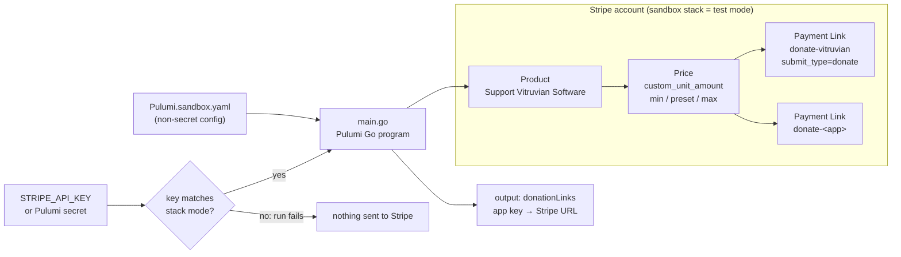
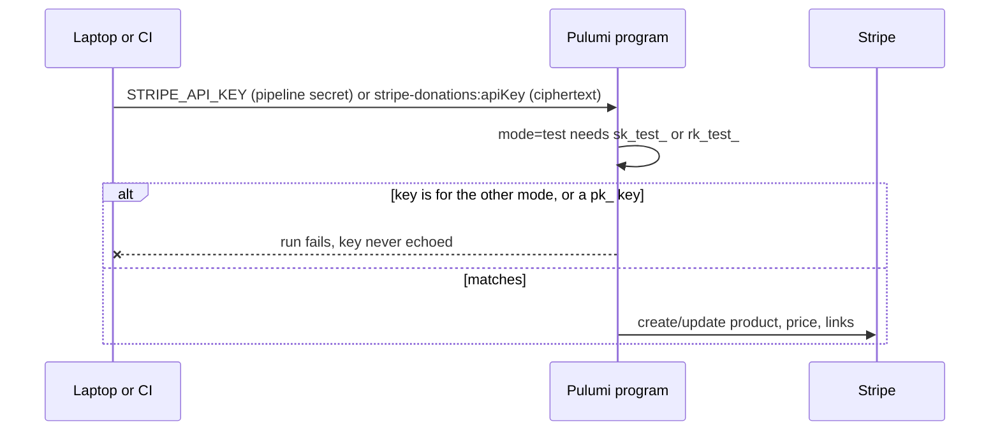
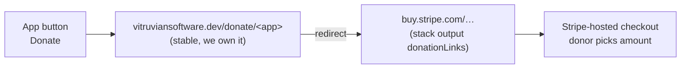

<!--
Copyright (c) 2026 VitruvianSoftware

Permission is hereby granted, free of charge, to any person obtaining a copy
of this software and associated documentation files (the "Software"), to deal
in the Software without restriction, including without limitation the rights
to use, copy, modify, merge, publish, distribute, sublicense, and/or sell
copies of the Software, and to permit persons to whom the Software is
furnished to do so, subject to the following conditions:

The above copyright notice and this permission notice shall be included in
all copies or substantial portions of the Software.

THE SOFTWARE IS PROVIDED "AS IS", WITHOUT WARRANTY OF ANY KIND, EXPRESS OR
IMPLIED, INCLUDING BUT NOT LIMITED TO THE WARRANTIES OF MERCHANTABILITY,
FITNESS FOR A PARTICULAR PURPOSE AND NONINFRINGEMENT. IN NO EVENT SHALL THE
AUTHORS OR COPYRIGHT HOLDERS BE LIABLE FOR ANY CLAIM, DAMAGES OR OTHER
LIABILITY, WHETHER IN AN ACTION OF CONTRACT, TORT OR OTHERWISE, ARISING FROM,
OUT OF OR IN CONNECTION WITH THE SOFTWARE OR THE USE OR OTHER DEALINGS IN THE
SOFTWARE.
-->

# stripe-donations

Donation buttons for Vitruvian Software's free apps, with the Stripe side kept
as code: one **Product**, one **pay-what-you-want Price**, and one **Payment
Link per app**. Pulumi-in-Go like every other stack here; underneath, it uses
**Stripe's own Terraform provider** through Pulumi's `terraform-provider`
package.

> **Status: scaffold.** Nothing is deployed and nothing here has called Stripe.
> `main.go` is build-tagged out until the Stripe Go SDK is generated (below).
> The sandbox stack targets Stripe **test mode** and refuses a live key.

## What it builds



One shared price keeps the suggested amount in one place. One link per app
keeps attribution: each link carries `metadata.app`, so Stripe's dashboard and
exports show which app a donation came from, at no extra cost.

## Why this provider

| Option | Maintainer | Has Payment Links + pay-what-you-want? | Fit |
|---|---|---|---|
| **Stripe's provider** `stripe/stripe` via Pulumi `terraform-provider` | Stripe (generated from its API spec, MIT) | Yes: `stripe_payment_link`, `stripe_price.custom_unit_amount` (v0.3.0) | **Chosen** |
| `georgegebbett/pulumi-stripe` | One community maintainer, bridges `lukasaron/terraform-provider-stripe` | Partly, older | Go SDK self-described as unverified |
| Hand-written custom provider over the Stripe API | Us | Whatever we write | Most code to own; Go has no dynamic providers |

Verified on 2026-11-07: v0.3.0 of `github.com/stripe/terraform-provider-stripe`
(tagged 2026-08-13) ships `resource_stripe_payment_link.go`, `submit_type`
accepts `donate`, and `custom_unit_amount` changes are `RequiresReplace`.
The Pulumi registry lists the `stripe` package at 0.3.0 (2026-08-14).

**This is a new mechanism for the repo** (a parameterized package plus a
locally generated SDK, rather than a published `pulumi-<x>` Go module), so per
the [principles](../../../../docs/engineering/application-development-principles.md)
it needs a maintainer yes before it lands.

## Generating the Stripe SDK

Needs the Pulumi CLI (>= 3.147) and network access to the Terraform registry.

```sh
cd infrastructure/pulumi/platform/stripe-donations
GOWORK=off pulumi package add terraform-provider registry.terraform.io/stripe/stripe 0.3.0
GOWORK=off go mod tidy
```

That writes the SDK to `sdks/stripe`, adds a `replace` for
`github.com/pulumi/pulumi-terraform-provider/sdks/go/stripe` to `go.mod`, and
re-pins `packages:` in `Pulumi.yaml`. Then, in the same commit: delete the
`//go:build ignore` line from `main.go`, fix anything the real SDK types
disagree with, and commit `sdks/stripe` so CI and clean checkouts build. Keep
the package versions in `Pulumi.yaml` and the SDK in step.

## Keys and modes



- Use a **restricted key** (`rk_test_…`) limited to writing Products, Prices
  and Payment Links, from a Stripe sandbox.
- Locally: `export STRIPE_API_KEY=…` for the session, or
  `bazel run //infrastructure/pulumi/platform/stripe-donations:config -- set --secret apiKey --stack sandbox`
  (stores ciphertext only). A test fails if a plaintext key lands in the stack file.
- Live mode is a separate stack (`Pulumi.live.yaml`, `mode: live`), which also
  turns on `protect` for the product and links.

## How apps show the button

A Payment Link can't be deleted (the provider's delete only deactivates it),
and a replaced link gets a new URL. Shipped desktop builds can't be updated
when that happens, so **apps never embed the Stripe URL**. They open a stable
address we own, which forwards to the current link.



| App | Where the button goes |
|---|---|
| Vitruvian (desktop) | Already built: Settings > Support has a Donate button calling `AppInfo.coffeeURL`, hidden while `AppInfo.hasCommunityChannels` is false. Point `coffeeURL` at the redirect and show the page. |
| HomeSpeaker, NexusAgent, Courier (desktop) | A "Support" item in the menu-bar menu or Settings that opens the redirect in the browser. |
| devx, homelab (CLIs) | A line in `--version` / README, plus a `.github/FUNDING.yml` `custom:` entry for the mirrors. |
| vitruviansoftware.dev | The redirect pages themselves (a `_data` file of app → link), plus a Support link on Downloads. |

## Not in this change

- **Applying it.** No `:up` from a laptop; a `delivery()` declaration and a
  `STRIPE_API_KEY` GitHub Environment secret (declared in `repo-config`) come
  with the first real apply.
- The redirect pages on the website and the app changes above.
