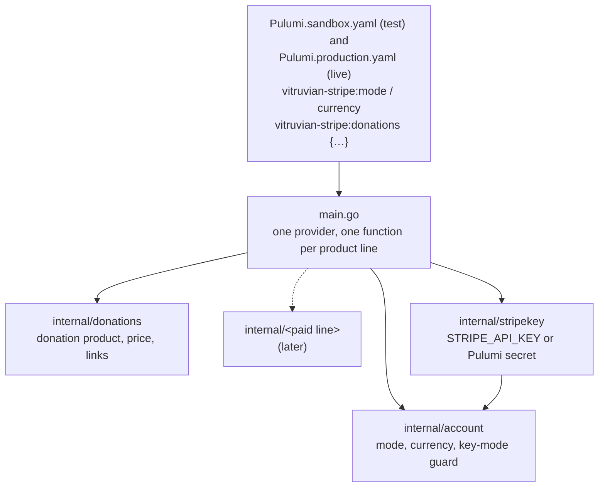
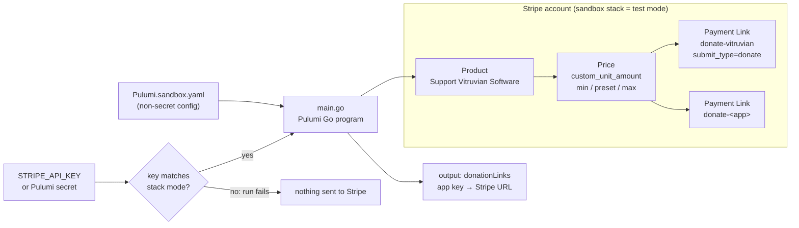
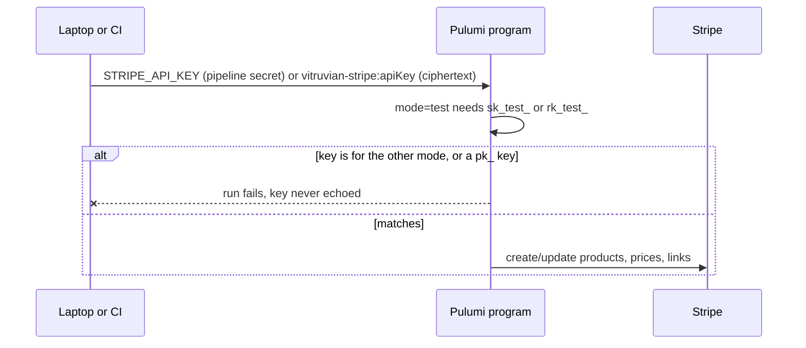
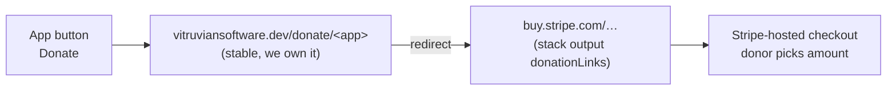
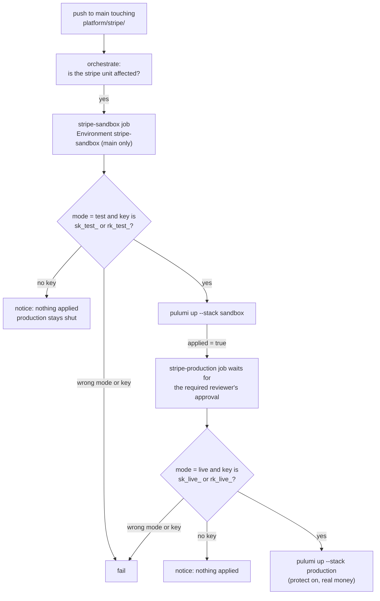

<!--
Copyright (c) 2026 VitruvianSoftware

Permission is hereby granted, free of charge, to any person obtaining a copy
of this software and associated documentation files (the "Software"), to deal
in the Software without restriction, including without limitation the rights
to use, copy, modify, merge, publish, distribute, sublicense, and/or sell
copies of the Software, and to permit persons to whom the Software is
furnished to do so, subject to the following conditions:

The above copyright notice and this permission notice shall be included in
all copies or substantial portions of the Software.

THE SOFTWARE IS PROVIDED "AS IS", WITHOUT WARRANTY OF ANY KIND, EXPRESS OR
IMPLIED, INCLUDING BUT NOT LIMITED TO THE WARRANTIES OF MERCHANTABILITY,
FITNESS FOR A PARTICULAR PURPOSE AND NONINFRINGEMENT. IN NO EVENT SHALL THE
AUTHORS OR COPYRIGHT HOLDERS BE LIABLE FOR ANY CLAIM, DAMAGES OR OTHER
LIABILITY, WHETHER IN AN ACTION OF CONTRACT, TORT OR OTHERWISE, ARISING FROM,
OUT OF OR IN CONNECTION WITH THE SOFTWARE OR THE USE OR OTHER DEALINGS IN THE
SOFTWARE.
-->

# stripe

Vitruvian Software's Stripe account as code: products, prices and Payment
Links, through **Stripe's own Terraform provider** bridged into Pulumi-in-Go
with Pulumi's `terraform-provider` package. The first product line is
**donations** for the free apps: one **Product**, one **pay-what-you-want
Price**, and one **Payment Link per app**. Paid products come later as a
second product line in the same stack.

> **Status: wired, waiting on the keys.** The `stripe` delivery unit applies two
> stacks from CI on every push to `main` that touches them: the **sandbox**
> (Stripe test mode) first, then **production** (live mode), which also waits
> for a required reviewer. Each refuses the other mode's key. Until an
> Environment holds its `STRIPE_API_KEY`, that rung says so and applies nothing,
> and production never starts unless the sandbox really applied. See
> [Applying it](#applying-it).

## Layout



Config is split the same way: account-wide keys at the top level, and one
object per product line (`vitruvian-stripe:donations` today). A paid line adds
a sibling object and a package beside `internal/donations`, without touching
the donation resources.

The Pulumi project is named `vitruvian-stripe`, not `stripe`, because `stripe:`
is the provider package's own config namespace (`stripe:apiKey`). Pulumi keys
stack state on that name, so it stays fixed once a stack exists.

## What it builds



For donations, one shared price keeps the suggested amount in one place. One link per app
keeps attribution: each link carries `metadata.app`, so Stripe's dashboard and
exports show which app a donation came from, at no extra cost.

## Why this provider

| Option | Maintainer | Has Payment Links + pay-what-you-want? | Fit |
|---|---|---|---|
| **Stripe's provider** `stripe/stripe` via Pulumi `terraform-provider` | Stripe (generated from its API spec, MIT) | Yes: `stripe_payment_link`, `stripe_price.custom_unit_amount` (v0.3.0) | **Chosen** |
| `georgegebbett/pulumi-stripe` | One community maintainer, bridges `lukasaron/terraform-provider-stripe` | Partly, older | Go SDK self-described as unverified |
| Hand-written custom provider over the Stripe API | Us | Whatever we write | Most code to own; Go has no dynamic providers |

Verified on 2026-11-07: v0.3.0 of `github.com/stripe/terraform-provider-stripe`
(tagged 2026-08-13) ships `resource_stripe_payment_link.go`, `submit_type`
accepts `donate`, and `custom_unit_amount` changes are `RequiresReplace`.
The Pulumi registry lists the `stripe` package at 0.3.0 (2026-08-14).

**This is a new mechanism for the repo** (a parameterized package plus a
locally generated SDK, rather than a published `pulumi-<x>` Go module), which
the [principles](../../../../docs/engineering/application-development-principles.md)
put to the maintainer. James approved it, committed SDK included, on
2026-11-07.

## Regenerating the Stripe SDK

`sdks/stripe` is generated and committed (2026-11-07: terraform-provider
1.5.0 bridging `stripe/stripe` 0.3.0), so CI and clean checkouts build without
the Pulumi CLI. Regenerate it whenever either version in `Pulumi.yaml`
changes. Needs the Pulumi CLI (>= 3.147) and network access to the Terraform
registry.

```sh
cd infrastructure/pulumi/platform/stripe
GOWORK=off pulumi package add terraform-provider registry.terraform.io/stripe/stripe 0.3.0
GOWORK=off go mod tidy
```

That rewrites `sdks/stripe`, keeps the `replace` for
`github.com/pulumi/pulumi-terraform-provider/sdks/go/stripe` in `go.mod`, and
re-pins `packages:` in `Pulumi.yaml`. Then, in the same commit:

- set the `go` directive in `sdks/stripe/go.mod` back to the one in `go.work`
  (the generator writes an older one, and `//tools/conformance:check` holds
  every `go.mod` to the repo's Go version);
- fix anything the new SDK types disagree with in `main.go`;
- keep the versions in `Pulumi.yaml` and the SDK in step.

The SDK is exempt from the MIT header check (`//tools/license`), as generated
code.

## Keys and modes



- Use a **restricted key** (`rk_test_…`) limited to writing Products, Prices
  and Payment Links, from a Stripe sandbox.
- Locally: `export STRIPE_API_KEY=…` for the session, or
  `bazel run //infrastructure/pulumi/platform/stripe:config -- set --secret apiKey --stack sandbox`
  (stores ciphertext only). A test fails if a plaintext key lands in the stack file.
- Live mode is the `production` stack ([`Pulumi.production.yaml`](Pulumi.production.yaml),
  `mode: live`), which needs `sk_live_`/`rk_live_` and also turns on `protect`
  for the product and links. Its donations settings must equal the sandbox's
  (a test fails otherwise), so the sandbox run rehearses exactly what goes live.

## How apps show the button

A Payment Link can't be deleted (the provider's delete only deactivates it),
and a replaced link gets a new URL. Shipped desktop builds can't be updated
when that happens, so **apps never embed the Stripe URL**. They open a stable
address we own, which forwards to the current link.



| App | Where the button goes |
|---|---|
| Vitruvian (desktop) | Already built: Settings > Support has a Donate button calling `AppInfo.coffeeURL`, hidden while `AppInfo.hasCommunityChannels` is false. Point `coffeeURL` at the redirect and show the page. |
| HomeSpeaker, NexusAgent, Courier (desktop) | A "Support" item in the menu-bar menu or Settings that opens the redirect in the browser. |
| devx, homelab (CLIs) | A line in `--version` / README, plus a `.github/FUNDING.yml` `custom:` entry for the mirrors. |
| vitruviansoftware.dev | The redirect pages themselves (a `_data` file of app → link), plus a Support link on Downloads. |

## Applying it

No `:up` from a laptop. The `stripe` `delivery()` unit in [`BUILD`](BUILD)
renders the `stripe-sandbox` and `stripe-production` jobs of
[`delivery-stripe.yaml`](../../../../.github/workflows/delivery-stripe.yaml)
(generated; their steps live in `//tools/delivery/gen`, `render_stripe_steps`).



A dispatch of `delivery-stripe.yaml` names one environment and runs only that
rung (production still waits for the reviewer).

| Stack | GitHub Environment | Secret | Accepts | Gate |
|---|---|---|---|---|
| `sandbox` | `stripe-sandbox` | `STRIPE_API_KEY` | `sk_test_…`, `rk_test_…` | merge to `main` |
| `production` | `stripe-production` | `STRIPE_API_KEY` | `sk_live_…`, `rk_live_…` | sandbox applied in the same run, then a required reviewer |

Both Environments are declared in
[`repo-config`](../repo-config/stripe_environments.go), and only `main` may
deploy to them, so no pull request can read a key. The secrets are set with
[`//tools/sync-env-secrets`](../../../../tools/sync-env-secrets/README.md#stripe-sandbox-and-stripe-production),
never by hand and never in git. Stripe creates API keys only in its Dashboard,
so each key starts there; use a restricted key limited to writing Products,
Prices and Payment Links.

```sh
bazel run //tools/sync-env-secrets:unlock
bazel run //tools/sync-env-secrets:set -- stripe-sandbox STRIPE_API_KEY
bazel run //tools/sync-env-secrets:set -- stripe-production STRIPE_API_KEY
bazel run //tools/sync-env-secrets:apply -- stripe-sandbox
bazel run //tools/sync-env-secrets:apply -- stripe-production
```

`set` prompts for the key without echoing it and backs the store up to
Bitwarden; `apply` puts it in the Environment.

Then push a change under this directory, or dispatch `delivery-stripe.yaml`
(unit `stripe`, environment `sandbox`). Each run's summary lists the product,
the price and one Payment Link URL per app.

## Not in this change

- The redirect pages on the website and the app changes above.
