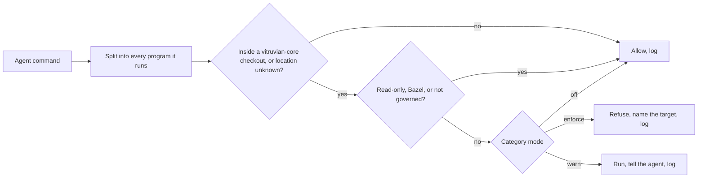

# agent-guard

AI agents working in vitruvian-core must run repo and dev operations through
Bazel targets: `bazel run //tools/git:commit`, not `git commit`; `bazel test`,
not `go test`. Instructions alone did not hold, so agent-guard enforces it. It
is a hook for Claude Code and Antigravity (agy) that reads each command an
agent is about to run and refuses the ones that have a Bazel route, naming the
target to use instead.

It is a **guardrail, not a security boundary**. It reads command text, so it
stops habits; a determined workaround (a script that calls git inside it) gets
past it. Agents are told not to route around it.

**James's own terminal is never affected.** Hooks run only inside agent loops.
There is no escape hatch for agents: if a target is missing, the refusal says
so and tells the agent to stop and tell James.



## Install

**Not before the targets land.** The guard sends agents to targets that are
still being built, so the installer refuses to install from a checkout that
does not have all of them: `tools/git/BUILD` declaring `commit`, `push` and
`sync`; `tools/secret-scan/BUILD`; and `pr-enqueue` in
`tools/agent-app/agent-app.sh`, so arming auto-merge has a route on day one.
The refusal names what is missing. Pull main once those are merged, then run it
from your own terminal. Inside an agent
session (`CLAUDECODE`, `ANTIGRAVITY_AGENT`, any other `ANTIGRAVITY_*`, or
`GEMINI_CLI` set) it only runs `--dry-run` and `--check`.

```sh
bazel run //tools/agent-guard:install -- --dry-run   # see the exact change to both hook files
bazel run //tools/agent-guard:install                # install or update
bazel run //tools/agent-guard:install -- --check     # current and working? exit 1 if not
bazel run //tools/agent-guard:install -- --mode git-push=warn   # one category; `all=warn` for every one
bazel run //tools/agent-guard:install -- --uninstall # remove the hooks and the copy; the log stays
```

What it does:

- **Copies** `agent_guard.py` and `policy.json` to `~/.local/share/agent-guard/`
  with a `VERSION.json` stamp (version, source commit, checksum), plus
  `hook.py`, a two-line launcher that imports the guard so its compiled
  bytecode is cached, and `hook.sh`, which picks the Python (below). The hook points at that copy, not at a checkout: a worktree can be
  deleted, the main checkout changes on every pull, and an agent could weaken
  the policy by editing the repo's `policy.json`. The copy changes only when
  you reinstall.
- **Merges two `PreToolUse` entries** into `~/.claude/settings.json`, the user
  file, so they cover every project, worktree and subagent:
  - **command tools** (`Bash`, `Monitor`, the terminal panel, Desktop
    Commander's `start_process`/`interact_with_process`, the auto-merge tool,
    the kubernetes MCP write tools) with `onFailure: block` (Claude Code
    2.1.295+): if the hook cannot run, the command is refused, not let through;
  - **file tools** (`Edit`, `Write`, `MultiEdit`, `NotebookEdit`, Desktop
    Commander's `write_file`, `edit_block`, `move_file`, `create_directory`,
    `write_pdf`) with **no** `onFailure`. They are checked only to keep agents
    out of the guard's own folders, so a broken hook never stops code edits.

  Every other hook is kept, and the file keeps its formatting. It is backed up
  to `settings.json.agent-guard-<time>.bak` before each write. Running the
  installer twice changes nothing.
- **Merges one named hook, `agent-guard`, into `~/.gemini/config/hooks.json`**
  for Antigravity, if `~/.gemini` exists (details below). Other named hooks,
  such as `response-contract`, are kept; the file is backed up the same way.
- **Tests itself, and rolls back on failure.** After writing, it runs the
  installed hook on four sample calls, with every category enforced: in Claude
  Code's format `git status` must be allowed and `git stash` refused; in agy's
  real payload shape, run from a folder outside any checkout as agy does,
  `git status` must be allowed and `go vet` refused. If any fails, both hook
  files and the previous copy are put back and it says why. `--check` runs the
  same test and also checks the agy entry.
- The repo's own `.claude/block-queue-bypass.sh` hook stays. Both run, and
  either one's refusal wins.

**Which Python.** The hook command is `/bin/sh ~/.local/share/agent-guard/hook.sh`.
That script reads the tool call once and hands it to each of these in turn,
with `-I`, until one exits cleanly. It fails (and the command-tool entry then
refuses the command) only if none of them works:

1. the Python chosen at install: Homebrew's newest versioned link, such as
   `/opt/homebrew/opt/python@3.15/bin/python3.15`. It does not depend on Xcode
   or the Command Line Tools and survives patch upgrades, but if Homebrew
   installed it only as another formula's dependency, its automatic cleanup can
   remove it;
2. every `python@3.N` you installed yourself (`brew list --installed-on-request`;
   here `python@3.12`), which cleanup leaves alone;
3. `/Library/Developer/CommandLineTools/usr/bin/python3`: not tied to the
   selected Xcode, replaced in place by Command Line Tools updates;
4. `/usr/bin/python3`: Apple's shim, resolved through `xcode-select` on every
   call. It fails while Xcode is being replaced.

The installer caches the guard's bytecode for each of them (Apple's Python
never writes its own cache), so whichever runs starts fast: about 30 ms a call
on Homebrew's, 80-100 ms through Apple's shim. Pass `--python /abs/path/python3`
to choose the first. `--check` runs the self-test through the same script.

**Antigravity (agy).** Verified live against agy 1.4.0 on 2026-10-16: with
the entry below, agy refused `go vet ./...` and showed the agent the guard's
reason, let `git status` run, and the log recorded `"agent": "antigravity"`.
What the installer writes, and why:

```json
"agent-guard": {
  "enabled": true,
  "PreToolUse": [
    {"matcher": "run_command|shell_exec|send_command_input|manage_task|git_commit|write_to_file|replace_file_content|multi_replace_file_content|notebook_edit",
     "hooks": [{"type": "command", "command": "/bin/sh ~/.local/share/agent-guard/hook.sh", "timeout": 10}]}
  ]
}
```

- **Grouped shape only.** agy loads a flat `PreToolUse` entry (`type` and
  `command` beside `matcher`) but silently ignores it.
- **One regex matcher** against the tool name; plain `|` alternation was
  checked live. Which names are confirmed:
  - seen live in a hook payload: `run_command` (`CommandLine`, `Cwd`),
    `write_to_file` and `replace_file_content` (`TargetFile`);
  - in agy's own tool declarations, not yet seen in a hook payload:
    `multi_replace_file_content` (`TargetFile`), `notebook_edit`
    (`NotebookPath`), `manage_task` (`Action: "send_input"` with `Input`
    sends input to a running command);
  - in the agy binary only, never seen offered to the model, so their argument
    names are guesses: `shell_exec` (read like `run_command`; the guard tries
    `Command`, `command`, `CommandLine`), `send_command_input` (`Input` or
    `input`) and `git_commit` (refused as a commit whatever its arguments).
- **Where a command runs.** agy runs hooks in the folder holding `hooks.json`
  (`~/.gemini/config`), not the agent's, and sends no top-level `cwd`. The
  guard uses `args.Cwd`; without it, a `workspacePaths` entry inside
  vitruvian-core if any is, else the first one; without either, the location
  is unknown and the command is judged as if it were
  inside vitruvian-core. A missing location never means allowed.
- **Replies.** Allow prints nothing; deny prints
  `{"decision":"deny","reason":"..."}`. Warn mode prints nothing (agy has no
  "allow with a note" reply), so a warning reaches only the log.
- **A broken hook fails closed** (tested live on 2026-10-17 with agy 1.4.0).
  agy refused the `run_command` call when the hook exited 1, printed
  half-finished JSON, hung past its timeout, or could not start its
  interpreter (exit 126), and reported a failed JSON hook to the agent. A
  working hook let the same command run. See "If the hook breaks".

## If the hook breaks

A broken hook refuses every command an agent runs (by design: it fails
closed). In Claude Code, file edits keep working. Antigravity fails closed too
(tested live with agy 1.4.0: a hook that exits 1, prints half-finished JSON,
hangs past its timeout or has no interpreter makes agy refuse `run_command`,
reporting that a JSON hook failed), so a broken agent-guard also stops agy's
command runs. agy has one matcher for commands and file writes, so its file
edits are probably refused as well; only `run_command` was tested. `hook.sh`
trying several Pythons in turn is what makes a broken hook unlikely. To
recover, from **your own terminal** (hooks do not run there):

```sh
bazel run //tools/agent-guard:install -- --uninstall
```

It removes only agent-guard's entries from both hook files. A broken
`~/.gemini/config/hooks.json` does not stop it removing the Claude Code hook.
Or delete the entries by hand: in `~/.claude/settings.json`, under
`hooks.PreToolUse`, remove the entries whose `command` ends in
`.local/share/agent-guard/hook.sh`; in `~/.gemini/config/hooks.json`, remove
the `"agent-guard"` key. Backups of the file before each install are
beside it as `settings.json.agent-guard-<time>.bak`. Then find out why with
`bazel run //tools/agent-guard:install -- --check`, fix it, and reinstall.

## What is blocked, and what to use

Every category defaults to `enforce`. Some targets are still being built on
another branch; until one lands, the refusal says so and points to James.

| Category | Blocked | Use instead |
|---|---|---|
| `git-commit` | `git add`, `rm`, `mv`, `commit`, `apply --index`/`--3way` | `bazel run //tools/git:commit` |
| `git-push` | `git push` | `bazel run //tools/git:push` |
| `git-history` | `git rebase`, `merge`, `pull` (except `--ff-only` in the primary checkout) | `bazel run //tools/git:sync` |
| | `git reset`, `cherry-pick`, `revert`, `am`, `bisect`, `tag` | no target yet: tell James |
| `git-stash` | `git stash` except `list`/`show` (the stash is shared by every worktree) | commit to your branch, or use another worktree |
| `git-branch` | `git checkout -b`/`<branch>`, `git switch`, `git branch <new>`/`-m`, `gh pr checkout` | `bazel run //tools/worktree -- <branch> [base]` |
| | `git branch -d/-D` | `bazel run //tools/worktree -- --remove <branch> --delete-branch` or `--prune` |
| `git-worktree` | `git worktree add/remove/prune/lock/unlock`, `rm -r` of a worktree | `bazel run //tools/worktree` with `--detach <ref>`, `--remove`, `--prune`, `--lock`/`--unlock` |
| `git-other` | any other git verb that writes: `config` writes, `remote add`, `clean` (except `-n`), `gc`, `clone`, ... | no target: tell James |
| `gh-pr` | `gh pr create` | `bazel run //tools/agent-app -- pr-create` (PR #3427) |
| | `gh pr merge` (with or without `--auto`), the auto-merge MCP tool | `bazel run //tools/agent-app -- pr-enqueue <pr>` |
| | `gh pr edit/comment/ready/close/review` | `pr-edit`, `pr-comment`, `pr-ready` are planned in agent-app: tell James |
| `gh-run` | `gh workflow run/enable/disable`, `gh run rerun/cancel/delete` | no target yet: tell James |
| `gh-api` | `gh api` with a write method or fields, GraphQL mutations | no target: tell James |
| `gh-other` | other `gh` writes: `release create`, `secret set`, `label create`, ... | no target: tell James |
| `go` | `go test/vet/build/run/install/mod/get/fmt` | `bazel test`, `bazel build`, `//tools/gomod:tidy`, `//tools/format` |
| `swift` | `swift build/test/run/package`, `swiftc` | `bazel test //apps/desktop/<app>:<Tests>` |
| `xcode` | `xcodebuild`, `xcrun notarytool/stapler/altool` | the app's `bazel build`/`test` and packaging targets |
| `node` | `npm`/`pnpm`/`yarn`/`bun` install, test, run, exec; `npx` | `bazel test` / `bazel run`; Bazel installs node_modules itself |
| `cargo` | `cargo build/test/run/check/clippy/publish` | `bazel test` / `bazel build` |
| `gradle` | `gradle`, `./gradlew` | `bazel build //apps/mobile/<app>:app` |
| `pytest` | `pytest`, `python -m pytest`, `uv run pytest` | `bazel test` |
| `lint` | `gofmt`, `golangci-lint`, `ruff`, `eslint`, `prettier`, `shellcheck`, `buildifier`, ... | `bazel run //tools/format` (or `//:tidy`), `aspect lint` |
| `actionlint` | `actionlint` | `bazel run //tools/ci:actionlint` |
| `secret-scan` | `gitleaks` | `bazel run //tools/secret-scan` |
| `iac` | `pulumi` (anything but read-only commands like `stack ls`), `terraform apply/destroy/import` | `bazel run //infrastructure/pulumi/<project>:preview` |
| `kubectl` | `apply/delete/patch/create/replace` | `bazel run //tools/gitops:{apply,delete,patch}`, or change git |
| | `edit/exec/rollout restart/scale/label/...` | no target: tell James |
| `helm` | `install/upgrade/uninstall/rollback` | `bazel run //tools/gitops:helm`, or change git |
| `bazel-cache` | `rm -r` of `~/.cache/bazel`, `~/Library/Caches/bazel` or `_bazel_*`; `find -delete` there; `bazel clean --expunge`; `--output_user_root`/`--output_base` | `bazel run //tools/bazel-cache:gc` |
| `guard-config` | agents editing or removing the installed guard, its policy or its log; running the installer (`bazel run`, `bazel-bin/.../install` or `install.py`) without `--dry-run`/`--check`; hiding the agent session (`CLAUDECODE=`/`ANTIGRAVITY_*=`/`GEMINI_CLI=` prefixes, `env -u`, `env -i`, `unset`, `export -n`) in a command that runs anything agent-guard. Matched on the parsed commands, so `grep 'unset CLAUDECODE'` is just a grep | James does this from his own terminal |
| `oversize` | a command with more than 20,000 simple commands in it (the hook must answer inside its 10 s timeout, and command tools fail closed) | split it into smaller commands |

**Always allowed:** read-only git (`status log diff show fetch rev-parse
ls-files grep blame`, `branch` listing, `worktree list`, `merge-base`,
`cat-file`, `config --get`, `remote -v`, `stash list`, `tag -l`, `restore`,
`checkout -- <path>`, `apply <patch>` to the working tree, `clean -n`,
`pull --ff-only` in the primary checkout); read-only gh (`view list checks diff status`, `gh api` GETs and
GraphQL queries, `gh issue ...`); anything run by `bazel`, `bazelisk`,
`aspect` or `ibazel`; `--version` and `--help` of every tool; and every program
the guard does not govern (`cat`, `jq`, `ls`, `python3 -c`, `docker`, ...).

**Half-finished operations are never stranded.** While a merge, rebase or
cherry-pick is in progress (git's `MERGE_HEAD`, `REBASE_HEAD`/`rebase-merge`/
`rebase-apply` or `CHERRY_PICK_HEAD`, found with `git rev-parse --git-path`, so
worktrees work), these are allowed: `git merge --continue/--abort`,
`git rebase --continue/--abort/--skip`, `git cherry-pick --continue/--abort`,
and `git add` of the conflicted files by name. The same commands are refused
when nothing is in progress. A `git commit` that would conclude a merge points
to `bazel run //tools/git:commit`, which concludes it.

## What it sees through

It splits a command into every program it runs: `&&`, `||`, `;`, `|`,
newlines, `( )` and `{ }`, `$(...)`, backticks, `<(...)`, `if/for/while`
bodies, `bash -c`/`sh -c`/`zsh -lc`, `bash <<EOF` and `<<<`, `eval`, `env`
(including `-S`), `xargs`, `find -exec`, `watch`, `nice`, `time`, `timeout`,
`nohup`, `command`, `exec`, `sudo`, `caffeinate`, `direnv exec`, `uv run`,
`uvx` and `python -m`. It matches programs by basename (`/usr/bin/git` is git)
and follows `cd`, `git -C`, `--git-dir` and `--work-tree` to decide scope. A
heredoc fed to `cat` is data, including inside `"$(cat <<'EOF' ... EOF)"`
with apostrophes or backticks in the body; one fed to `bash` is a script. In
an UNQUOTED heredoc (`<<EOF`, not `<<'EOF'`) the shell runs every `$(...)` and
backtick in the body, so the guard checks those (`\$(...)` and `` \` `` stay
text).

## Scope

It governs only commands whose directory is inside a vitruvian-core checkout or
worktree: one with a `MODULE.bazel` declaring `module(name = "vitruvian_core")`.
Anywhere else, including other repos, it allows the command and logs it. Two
categories apply everywhere, because what they protect is not in the checkout:
`bazel-cache` and `guard-config`. A `gh` command that names its repository
(`-R`/`--repo`, a PR or issue URL, or a `repos/<owner>/<name>/` API path) is
scoped by that repository instead: vitruvian-core is in scope wherever the
command runs, and any other repository is out of scope even from inside this
checkout. `{owner}/{repo}` placeholders mean the current directory's repo.
For Antigravity the directory is `args.Cwd`, then a `workspacePaths` entry
inside vitruvian-core (or the first one if none is); with neither, the command is treated as inside (see Install).

## Modes

`tools/agent-guard/policy.json` sets each category to `enforce`, `warn` or
`off`. `enforce` refuses. `warn` lets the command run, tells the agent it would
have been refused, and logs it. `off` skips the check. A missing or broken
policy file means enforce everything. The installer copies the policy;
`--mode` changes only the installed copy, and a plain reinstall keeps modes you
set before.

## The log

Every command an agent runs through a covered tool is one JSON line in
`~/.local/state/agent-guard/log.jsonl`: time, agent (`claude-code` or
`antigravity`), tool, directory, scope, category, operation, decision, the
command (redacted, cut to 1,000 characters) and the session. For Antigravity
the directory is the one the guard judged by (empty if agy gave none, with
scope `unknown`) and the session is agy's `conversationId`. File edits are logged only when refused. The directory is 0700
and the file 0600. Secrets are replaced by `[REDACTED]`: values after
`--password`/`--token`/`--secret`, attached `-pPASSWORD` (not `git log -p 5`),
`curl -u user:pass`, `gh secret set ... --body`, `NAME_TOKEN=`/`*_KEY=`/
`password=`, `Authorization:`, `X-Api-Key:` and other `*-Key`/`*Token*`/
`*Secret*` headers, `Bearer`, `scheme://user:pass@` URLs, and GitHub, Slack,
OpenAI/Anthropic, AWS and Google (`AIza...`) key shapes. The file rolls over to `log.jsonl.1`
at 10 MB.

```sh
# What was refused today, by category
jq -r 'select(.decision=="deny") | .category' ~/.local/state/agent-guard/log.jsonl | sort | uniq -c | sort -rn
# The last ten refusals, with the command
jq -c 'select(.decision=="deny") | {ts, category, command}' ~/.local/state/agent-guard/log.jsonl | tail -10
# What warn mode would have refused
jq -c 'select(.decision=="warn")' ~/.local/state/agent-guard/log.jsonl
```

## Limits

- **It reads text.** A script that calls git inside it (`bash tools/x.sh`,
  `make`, a Python `subprocess`), a variable used as a command (`g=git; $g push`)
  or an alias is not seen. A second layer (agent-only `git`/`gh` shims on
  `PATH`) is planned to catch most of these.
- **Unquoted heredocs** (`<<EOF`) are only half-read. The guard checks the
  `$(...)` and backtick commands in the body, which the shell runs, but treats
  the rest as text: it does not expand variables, and a body piped into a
  shell (`cat <<EOF | sh`) is not read as a script. Quote the delimiter
  (`<<'EOF'`) when the body is meant as text.
- **Speed and size.** The hook decides a 1 MB single-word command or a 5 MB
  heredoc in well under a second (the tests hold each case under 1 s; most
  take 10-300 ms). It logs and redacts only the first 1,200 characters. A
  command with more than 20,000 simple commands in it is refused as
  `oversize` rather than checked.
- **It cannot see inside `bazel run`.** That is by design: targets run git
  freely. A target that misbehaves has to be fixed in the target.
- **Only the tools in its matchers.** A new MCP server or agy tool that runs
  commands or changes the repo is a gap until it is added to the matchers in
  `install.py` and to the tool tables in `agent_guard.py`.
- **Edits to `~/.claude/settings.json` or `~/.gemini/config/hooks.json` are
  not blocked**, so an agent could in principle remove the hook that way;
  `--check` shows it.
- **Agent detection is by environment marker** (`CLAUDECODE`,
  `ANTIGRAVITY_AGENT`, `ANTIGRAVITY_*`, `GEMINI_CLI`). `ANTIGRAVITY_AGENT=1` is
  in the agy binary; the Gemini CLI marker is the `GEMINI_CLI` name its
  wrapper uses. Neither was seen live in an agent shell.
- **`git checkout <name>`** is treated as a file restore when `<name>` exists
  as a path, and as a branch switch otherwise.
- **Antigravity** is guarded through the hook above, verified live for
  `run_command`, and a broken hook fails closed there. Not verified: the real
  argument names of `shell_exec`, `send_command_input` and
  `git_commit`. The older Gemini CLI has no usable hook.
- Each refusal costs the agent a turn; expect some friction at first.

## Tests

```sh
bazel test //tools/agent-guard/...
```

`agent_guard_test` replays a table of 400+ real commands (from a week of agent
logs) against expected decisions, plus redaction, scope, modes, the hook's
input and output in both formats (including agy's captured payload shape,
the missing-`Cwd` fallback and the log fields), a real git merge conflict, and
timing on 100 KB, 1 MB and 5 MB inputs. `install_test` runs the installer
against a temporary HOME: merge, the two Claude Code entries and the agy entry,
idempotence, dry run, uninstall, modes, the self-test and rollback, the
interpreter fallback, the targets-first refusal and refusal inside an agent
session.
