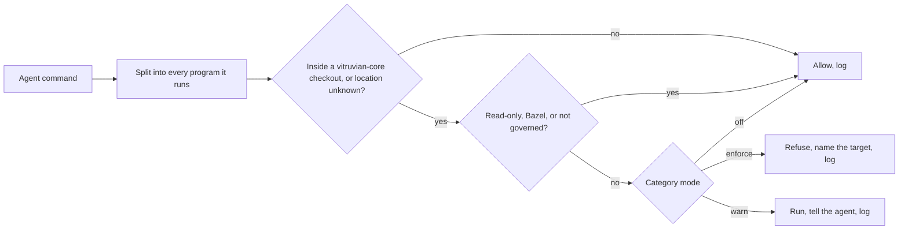
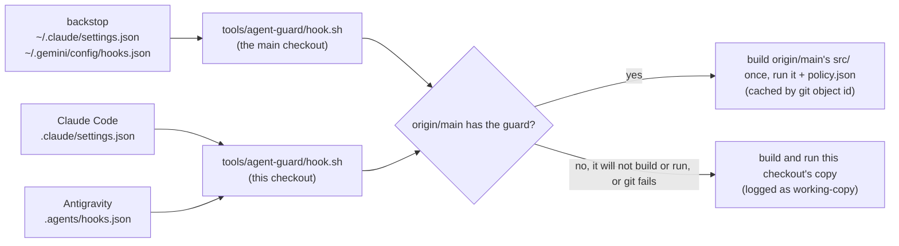
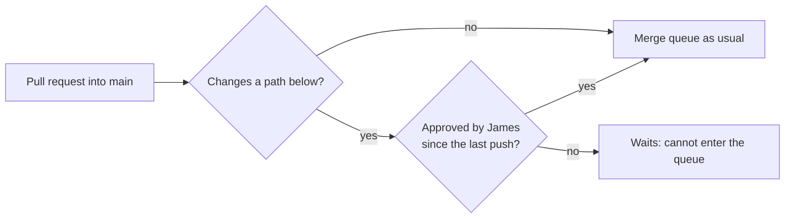

# agent-guard

AI agents working in vitruvian-core must run repo and dev operations through
Bazel targets: `bazel run //tools/git:commit`, not `git commit`; `bazel test`,
not `go test`. Instructions alone did not hold, so agent-guard enforces it. It
is a hook for Claude Code and Antigravity (agy) that reads each command an
agent is about to run and refuses the ones that have a Bazel route, naming the
target to use instead. It runs from the repo itself: every checkout and
worktree is guarded with nothing to install (see "How it is wired").

It is a **guardrail, not a security boundary**. It reads command text, so it
stops habits; a determined workaround (a script that calls git inside it) gets
past it. Agents are told not to route around it.

**James's own terminal is never affected.** Hooks run only inside agent loops.
There is no escape hatch for agents: if a target is missing, the refusal says
so and tells the agent to stop and tell James.



## How it is wired: from the repo, plus a thin per-user backstop

Every checkout and worktree is guarded the moment it exists: the repo carries
the hook itself. Project hooks only load in a session STARTED inside
vitruvian-core, though, so a one-time per-user backstop covers sessions started
anywhere else (below).



- **Claude Code**: `.claude/settings.json` has two `PreToolUse` entries, both
  running `/bin/sh "$CLAUDE_PROJECT_DIR/tools/agent-guard/hook.sh"`:
  - **command tools** (`Bash`, `Monitor`, the terminal panel, Desktop
    Commander's `start_process`/`interact_with_process`, the auto-merge tool,
    the kubernetes MCP write tools) with `onFailure: block`: if the hook
    cannot run, the command is refused, not let through. Claude Code honours
    this in project settings: the hooks reference's own example of it is a
    `PreToolUse` hook "in `.claude/settings.json`" (Hooks reference, "Block the
    action when a hook fails"; Claude Code 2.1.295+, here 2.1.302);
  - **file tools** (`Edit`, `Write`, `MultiEdit`, `NotebookEdit`, Desktop
    Commander's `write_file`, `edit_block`, `move_file`, `create_directory`,
    `write_pdf`) with **no** `onFailure`. They are checked only to protect the
    guard's own files, so a broken hook never stops code edits.

  `"disableAllHooks": false` is set there too. Project settings outrank user
  settings, so a user-level `true` cannot switch the guard off in the repo
  (Hooks reference, "Disable or remove hooks": a `"disableAllHooks": false`
  "in a project's `.claude/settings.json` overrides a `true` in your user
  settings").

  The repo's `.claude/block-queue-bypass.sh` hook stays beside them. Both run,
  and either one's refusal wins. Project hooks need the folder trusted in an
  interactive session; `-p` and SDK sessions always run them.
- **Antigravity (agy)**: `.agents/hooks.json` has one named hook,
  `agent-guard`, in the grouped shape (details below). agy runs a hook from the
  folder holding its `hooks.json`, so the command is
  `/bin/sh ../tools/agent-guard/hook.sh`.

**The launcher, `hook.sh`**, finds the checkout from its own path, never from
the working folder (agy runs it from `.agents/`, Claude Code from wherever the
agent is). Then:

1. **It runs the guard as it is on `origin/main`, not this checkout's copy.**
   The guard is Rust, standard library only. `git rev-parse
   origin/main:tools/agent-guard/src` (and `policy.json`) gives their git
   object ids; the first call after main changes extracts that `src/` and
   compiles it with plain `rustc -O` into
   `~/.local/state/agent-guard/cache/guard-<id>`, and later calls reuse the
   binary. So an agent's edit to `src/` or `policy.json` in a worktree governs
   nothing until it is merged, and agents may edit those files like any other
   code; the pull request then waits for James's approval (see "Who may do
   what"). `origin/main` is as fresh as your last fetch. The cache is not in
   `$TMPDIR`: agents can write there, and the next id is predictable, so an
   agent could plant a binary that allows everything.
2. **If that is not possible**, because there is no `origin/main`, main has no
   guard, git is missing, the cache cannot be written, or main's copy will
   not build or exits non-zero, it builds and runs this checkout's copy
   (cached by a checksum of its source) and says so: on stderr, and in the
   log's `source` field (`working-copy (why)` instead of `origin/main:<id>`).
   If that will not build or run either, it runs the newest build of main it
   made before (`origin/main:<id> (stale: why)`): never an older working
   copy, which could be an agent's unreviewed edit. A source that no rustc
   here builds is remembered (`guard-<id>.failed`), so later calls do not pay
   for the attempt again until the set of compilers changes.
3. **It tries each rustc it can find in turn**: rustup's toolchains (their own
   binaries, not rustup's `~/.cargo/bin` proxy, which can stop to download a
   toolchain), Homebrew's, Bazel's rules_rust toolchains in the output bases,
   then whatever `rustc` is on `PATH`. It exits 1 only if no copy of the guard
   builds and runs, and the call is then refused (Claude Code's `onFailure:
   block`; agy always fails closed).

**Speed.** The first call after main changes compiles the guard: about 2.5 s
on this Mac. Later calls cost about 50 ms (median of 30, measured on the
working-copy path, which also checksums `src/`): `sh`, ~8 ms for the `git
rev-parse`, and the guard itself, which starts in a few milliseconds.

**The guard's own files are protected** (category `guard-config`): agents may
not write, move or delete `.claude/settings.json`, `.claude/settings.local.json`
(it could switch hooks off), the hook scripts `.claude/*.sh` (session-start,
block-queue-bypass, kube-setup, tailscale-up: they run from the project
settings), `.agents/hooks.json`, `tools/agent-guard/hook.sh`, or the
repo file that drives session start from the working copy with the
session's credentials (`tools/remote/setup.sh`, the build-cache configurator
`cloud-bootstrap.sh` runs) in any
vitruvian-core checkout, through the file tools or the obvious shell
writes (`>`, `tee`, `cp` onto them, `mv`, `rm`, `sed -i`, `perl -i`,
`python -c` that writes, `chmod`). Those take effect before review, so
changing them is James's call. Reading them, `git diff`, and running the
launcher by hand are fine. The rest of `tools/agent-guard/` is ordinary code
to edit, though merging any change to it needs James's approval (below).

**Fetches that could move origin/main are refused** (category `git-other`),
because origin/main is what hook.sh runs: a `src:dst` refspec
(`git fetch https://github.com/someone/fork +main:refs/remotes/origin/main`,
`git fetch origin main:main`), `--refmap`, or a `-c remote.*`/`-c url.*`
override, on `git fetch` or `git pull`. `git fetch`, `git fetch origin` and
`git fetch -q origin main` stay allowed.

**Checking it.**

```sh
bazel run //tools/agent-guard:install -- --check
```

It fails if agent-guard's entries in either repo file are missing or differ
from the installer's `claude_entries()`/`agy_entry()`, if
`"disableAllHooks": false` is missing, or if the backstop is missing, still
the old copy, or points at a `hook.sh` that is gone. Then it runs the repo
launcher and the backstop on sample tool calls in Claude Code's and agy's real
payload shapes, from the folder each runs them in: `git status` must be
allowed, `git stash` (Claude Code) and `go vet` (agy) refused. It says which
copy of the guard answered.

### The per-user backstop

Claude Code loads `.claude/settings.json` only for a session started inside
the checkout, and agy loads `.agents/hooks.json` only when started there
(checked live on 2026-10-17: agy started in another folder ran a command in a
worktree of this branch, and only the per-user hook logged it). A session
started in `~`, another repo or Cowork that then works here would be
unguarded. So install it once (an agent may do this; see "Who may do what"):

```sh
bazel run //tools/agent-guard:install -- --dry-run   # see the exact change to both user files
bazel run //tools/agent-guard:install
```

It merges the same two Claude Code entries into `~/.claude/settings.json`, and
the same `agent-guard` hook into `~/.gemini/config/hooks.json` if `~/.gemini`
exists. The command is a short `/bin/sh -c '...'` script written into the
entry itself (`BACKSTOP_SCRIPT` in `install/installer.rs`), given the main checkout's
absolute path, which is found from wherever you run the install, even a
worktree. If `<main checkout>/tools/agent-guard/hook.sh` exists, the script
runs it. Nothing is copied:

- **Guard changes need no reinstall.** The backstop runs the main checkout's
  `hook.sh`, which loads the guard from `origin/main`, so changes arrive with
  a pull or fetch.
- **Moving or deleting the main checkout needs a reinstall**, as does
  checking out a branch there that predates `hook.sh`. Until then the script
  finds no launcher and fails closed **only for vitruvian-core**: a call whose
  payload names the main checkout or its `-worktrees/` sibling is refused with
  "agent-guard: its launcher is missing from <main>; James must reinstall..."
  (Claude Code: exit 2 with that reason; agy: its deny JSON). Every other call,
  in any other repo, is let through with a warning on stderr. `--check` says
  so; reinstall, or `--uninstall`.
- **It migrates the old install.** Entries that point at the old copy in
  `~/.local/share/agent-guard` are replaced, and that copy is deleted, once the
  new entries pass a self-test (`git status` allowed, `git stash` and `go vet`
  refused, in both payload shapes, from a folder outside any checkout). If the
  self-test fails, or a write fails part-way, both files are put back and
  nothing is deleted.
- Every other hook is kept, each file is backed up beside itself before a
  write, and running it twice changes nothing. `--uninstall` removes only
  agent-guard's entries (and any old copy); the log stays.

### Who may do what

| | Agents | James only |
|---|---|---|
| `bazel run //tools/agent-guard:install` (install or refresh the backstop) | yes, after the checks below | |
| `-- --check`, `-- --dry-run`, `-- --uninstall --dry-run` (shows James the change) | yes | |
| `-- --uninstall` | | yes |
| changing modes (a `policy.json` change he merges; `--mode` is refused) | | yes |
| the first switch from the old copied install | | yes |
| pointing the backstop at a different checkout | | yes |
| other settings in `~/.claude/settings.json` and `~/.gemini/config/hooks.json` | yes, with Claude Code's Edit, MultiEdit or Write, leaving agent-guard's entries alone | |
| editing agent-guard's rules on a branch and opening the pull request | yes | |
| approving that pull request so it can merge | | yes |

**Changes to agent-guard's rules need James's approval to merge** (James
approved this on 2026-10-17). Without it, main needs no review at all, and
agents arm auto-merge on their own pull requests, so an agent could have
weakened the guard without James seeing it.



A pull request that changes any of these waits until `ipv1337`, through the
`agent-guard-approvers` team, approves it:

- `tools/agent-guard/**` (`policy.json` decides what is blocked; the guard and
  launcher load from origin/main)
- `.claude/settings.json`
- `.claude/settings.local.json`
- `.claude/*.sh`
- `.agents/hooks.json`
- `tools/cloud-bootstrap/cloud-bootstrap.sh`, `tools/cloud-bootstrap/profiles.tsv`
  and `tools/remote/setup.sh` (they run or steer session start, before
  review, with the session's credentials; `profiles.tsv` decides which
  secrets each session fetches)
- the requirement itself: `infrastructure/pulumi/platform/repo-config/guard_review.go`
  (the rule and the team), `infrastructure/pulumi/platform/repo-config/main.go`
  (where it is wired in, and the merge-queue ruleset's bypass list),
  `infrastructure/pulumi/platform/repo-config/Pulumi.yaml` and
  `infrastructure/pulumi/platform/repo-config/Pulumi.dev.yaml` (the stack)

How it works and what it does not do:

- **It is a GitHub ruleset** (`agent-guard-review`, declared in
  `guard_review.go` and applied by repo-config's CI on merge), using GitHub's
  required-reviewers rule. Pull requests that change none of these paths are
  unaffected: they still need no approval.
- **A new push makes the approval stale.** Any push to the branch, a sync with
  main included, dismisses it, and James approves again. This applies to every
  pull request into main (GitHub has no per-path version), but the others need
  no approval, so it only changes what their review list shows.
- **The merge queue needs nothing extra.** Approval is checked before a pull
  request can enter the queue; `pr-enqueue` arms auto-merge, which waits for it.
- **It proves the `ipv1337` account approved, not that James did.** Agents
  sometimes run `gh` as ipv1337; approving a pull request that way defeats the
  point, so never do it.
- **James cannot approve his own pull request.** One opened as ipv1337 needs
  his admin bypass (a direct merge, his break-glass), not an approval.
- **The break-glass bypasses this review too, the same as it bypasses the
  queue.** The ruleset's bypass list is the merge-queue ruleset's, read from
  the same code: repository admins and the copybara-sync App, both "always".
  A direct merge by either skips James's approval. Auto-merge never uses a
  bypass, so an agent's `pr-enqueue` always waits for the approval.
- **Not the whole delivery chain.** The rest of repo-config (`internal/`,
  `go.mod`) and the shared CI it runs on are not covered, to keep that work
  autonomous; they run with the same admin token and could in principle undo
  the rule.
- `bazel run //tools/conformance:check` fails if a pattern stops matching any
  file (a rename would otherwise drop the protection silently), or if this list
  is missing one.

The guard lets an agent run the target exactly as
`bazel run //tools/agent-guard:install`, or with only `--check`/`--dry-run`
(and `--uninstall` together with `--dry-run`) after `--`. It refuses a real
`--uninstall`, `--mode`, every other flag or argument (`--home`,
`--workspace`), any Bazel option on that command (`--run_under` or
`--script_path` could run it as something else, or without the agent marker),
running `bazel-bin/.../install` directly for anything but
those read-only flags, and hiding the agent marker.

**And only the installer as `origin/main` has it.** `bazel run` builds the
installer from the checkout it runs in, so an agent's own edit to it would
run with James's HOME and skip any check the installer makes. So the
guard, which itself runs from `origin/main`, allows any of those runs (`bazel
run`, or the direct read-only ones) only when, in that checkout,
`tools/agent-guard/BUILD` and every file under `src/` and `install/` (the
installer's crate and the guard library it links) are byte for byte
`origin/main`'s, a file added there counting as an edit, and no bazelrc that `bazel run` reads there (`/etc/bazel.bazelrc`,
the workspace `.bazelrc` and everything it imports, `user.bazelrc` included,
and `~/.bazelrc`) mentions `run_under` or `script_path` outside a comment.
An agent changing the installer tests it with `bazel test`, and runs it once
the change is on main.

The installer then checks again (a second line: an edited installer would
skip it, which is why the guard checks first). When it sees an agent marker
(`CLAUDECODE`, `ANTIGRAVITY_*`, `GEMINI_CLI`), it installs only if all of
these hold, and otherwise refuses with the reason:

- **It is the installer `bazel run` built from that checkout**: the program
  is the one Bazel built for `:install` (`.../bazel-out/<config>/bin/tools/agent-guard/install`)
  and `BUILD_WORKSPACE_DIRECTORY` names that checkout, whose installer
  sources are `origin/main`'s (the guard's check again).
- **The main checkout is the real one**: the parent of the git common dir of
  the checkout `bazel run` ran in (as for any install), a primary checkout
  whose `MODULE.bazel` declares `vitruvian_core` and whose `origin` is
  `github.com/VitruvianSoftware/vitruvian-core`. `--home` and `--workspace`
  are refused, so an agent installs only for its own HOME.
- **That checkout's `tools/agent-guard/hook.sh` and every file under
  `tools/agent-guard/src/` are byte for byte `origin/main`'s**, so the
  backstop never points at unreviewed launcher code, or a working copy of
  the guard the launcher could fall back to. A local edit or an unmerged commit there means "bring it up
  to date with main first"; no `origin/main` means "fetch first".
- **The old copied install is gone, and any backstop already there runs this
  same checkout.** Migrating off the old copy and moving the backstop are
  James's.
- **The result is exactly the standard entries** for that checkout, merged as
  usual: the files are read back and compared, then self-tested, and both are
  put back if either check fails.

Every install an agent runs, refused or not, is one line in the log
(`"event": "agent-install"`, with `outcome`, `reason`, `main`, the `marker`
and the `session`). `--dry-run` from an agent session also says whether an
agent may run the install, and why not.

**The first switch from the old copied install is James's.** A Mac still on
the old install (the guard copied to `~/.local/share/agent-guard`) runs that
copy as its per-user hook, and that copy refuses every agent install and does
not know this rule; the installer refuses an agent install while it is there as
well. So James runs `bazel run //tools/agent-guard:install` once, from his own
terminal. After that, agents can reinstall.

**Running twice is harmless.** In a session started inside the repo both the
project hook and the backstop run (their commands differ, so Claude Code does
not merge them). They run the same guard from the same `origin/main`, so they
give the same answer, and a refusal from either wins. Claude Code runs them
in parallel. agy seemed to run them one after the other: their log lines were
about 40 ms apart, and on a refusal only one of them logged. The log gets two
lines for each allowed call.

### Antigravity details

Verified live against agy 1.4.0. The entry in `.agents/hooks.json`:

```json
"agent-guard": {
  "enabled": true,
  "PreToolUse": [
    {"matcher": "run_command|shell_exec|send_command_input|manage_task|git_commit|write_to_file|replace_file_content|multi_replace_file_content|notebook_edit",
     "hooks": [{"type": "command", "command": "/bin/sh ../tools/agent-guard/hook.sh", "timeout": 10}]}
  ]
}
```

- **Read from the project.** agy reads `.agents/hooks.json` in the folder it
  runs in as well as `~/.gemini/config/hooks.json`, and runs a hook from the
  folder holding its file. Tested on 2026-10-17 in a worktree of this branch:
  agy refused `go vet ./does-not-exist-agent-guard-probe/...` with the guard's
  reason and let `git status` run, and the log showed the repo hook's lines
  (marked by forcing the launcher's working-copy path for the test) next to
  the per-user hook's. The same name in both files does not clash: both ran.
- **Grouped shape only.** agy loads a flat `PreToolUse` entry (`type` and
  `command` beside `matcher`) but silently ignores it.
- **One regex matcher** against the tool name; plain `|` alternation was
  checked live. Which names are confirmed:
  - seen live in a hook payload: `run_command` (`CommandLine`, `Cwd`),
    `write_to_file` and `replace_file_content` (`TargetFile`), and
    `manage_task` (`Action: "send_input"` with `Input` and `TaskId`, no `Cwd`;
    captured from agy 1.4.2 on 2026-10-17, when the model started `cat` and
    sent it a line);
  - in agy's own tool declarations, not yet seen in a hook payload:
    `multi_replace_file_content` (`TargetFile`), `notebook_edit`
    (`NotebookPath`);
  - in the agy binary only, **not offered to the model in agy 1.4.2** (checked
    live on 2026-10-17 in the default mode and with `--sandbox`: asked for each
    by name, the model had none of them), so their argument names are
    guesses: `shell_exec` (read like `run_command`; the guard tries `Command`,
    `command`, `CommandLine`), `send_command_input` (`Input` or `input`) and
    `git_commit` (refused as a commit whatever its arguments). If a later agy
    offers them, capture a real call and check.
- **Where a command runs.** agy sends no top-level `cwd`. The guard uses
  `args.Cwd`; without it, a `workspacePaths` entry inside vitruvian-core if any
  is, else the first one; without either, the location is unknown and the
  command is judged as if it were inside vitruvian-core. The hook's own folder
  (`.agents/`) is never used: a missing location never means allowed.
- **Replies.** Allow prints nothing; deny prints
  `{"decision":"deny","reason":"..."}`. Warn mode prints nothing (agy has no
  "allow with a note" reply), so a warning reaches only the log.
- **A broken hook fails closed** (tested live with agy 1.4.0): agy refused the
  `run_command` call when the hook exited 1, printed half-finished JSON, hung
  past its timeout, or could not start its interpreter.
- Not checked: whether agy started in a subfolder of the checkout still finds
  `.agents/hooks.json` at the top.

## If the hook breaks

A broken hook refuses every command an agent runs (by design: it fails
closed). In Claude Code, file edits keep working; in agy, which has one
matcher for commands and file writes, probably not. The launcher's rustc
fallbacks, its working-copy fallback and its last-resort older build make
this unlikely. Run
`bazel run //tools/agent-guard:install -- --check` from your own terminal
(hooks do not run there) to see why. To switch the guard off while you fix it,
from your own terminal: remove the two agent-guard entries from
`.claude/settings.json` and the `"agent-guard"` key from `.agents/hooks.json`
in the affected checkout (or set `"enabled": false` there), run
`bazel run //tools/agent-guard:install -- --uninstall` for the backstop, and
land the fix through a PR.

## What is blocked, and what to use

Every category defaults to `enforce`. Some targets are still being built on
another branch; until one lands, the refusal says so and points to James.

| Category | Blocked | Use instead |
|---|---|---|
| `git-commit` | `git add`, `rm`, `mv`, `commit`, `apply --index`/`--3way` | `bazel run //tools/git:commit` |
| `git-push` | `git push` | `bazel run //tools/git:push` |
| `git-history` | `git rebase`, `merge`, `pull` (except `--ff-only` in the primary checkout) | `bazel run //tools/git:sync` |
| | `git reset`, `cherry-pick`, `revert`, `am`, `bisect`, `tag` | no target yet: tell James |
| `git-stash` | `git stash` except `list`/`show` (the stash is shared by every worktree) | commit to your branch, or use another worktree |
| `git-branch` | `git checkout -b`/`<branch>`, `git switch`, `git branch <new>`/`-m`, `gh pr checkout` | `bazel run //tools/worktree -- <branch> [base]` |
| | `git branch -d/-D` | `bazel run //tools/worktree -- --remove <branch> --delete-branch` or `--prune` |
| `git-worktree` | `git worktree add/remove/prune/lock/unlock`, `rm -r` of a worktree | `bazel run //tools/worktree` with `--detach <ref>`, `--remove`, `--prune`, `--lock`/`--unlock` |
| `git-other` | any other git verb that writes: `config` writes, `remote add`, `clean` (except `-n`), `gc`, `clone`, ...; a `git fetch`/`pull` that names where it writes (`src:dst` refspec, `--refmap`, `-c remote.*`/`url.*`) | no target: tell James |
| `gh-pr` | `gh pr create` | `bazel run //tools/agent-app -- pr-create` (PR #3427) |
| | `gh pr merge` (with or without `--auto`), the auto-merge MCP tool | `bazel run //tools/agent-app -- pr-enqueue <pr>` |
| | `gh pr edit/comment/ready/close/review` | `pr-edit`, `pr-comment`, `pr-ready` are planned in agent-app: tell James |
| `gh-run` | `gh run rerun` | `bazel run //tools/agent-app -- run-rerun <run-id> [--failed] [--job <id>]` (wren only: the one App with Actions write) |
| | `gh run cancel` | `bazel run //tools/agent-app -- run-cancel <run-id>` (wren only) |
| | `gh workflow run` | `bazel run //tools/agent-app -- workflow-run <file.yaml> [-f k=v ...] [--ref main]` (wren only; workflows in `tools/agent-app/workflow-allowlist.txt`, in this repository) |
| | `gh run delete`, `gh workflow enable/disable` | no target yet: tell James |
| `gh-api` | `gh api` with a write method or fields, GraphQL mutations | no target: tell James |
| `gh-other` | other `gh` writes: `release create`, `secret set`, `label create`, ... | no target: tell James |
| `go` | `go test/vet/build/run/install/mod/get/fmt` | `bazel test`, `bazel build`, `//tools/gomod:tidy`, `//tools/format` |
| `swift` | `swift build/test/run/package`, `swiftc` | `bazel test //apps/desktop/<app>:<Tests>` |
| `xcode` | `xcodebuild`, `xcrun notarytool/stapler/altool` | the app's `bazel build`/`test` and packaging targets |
| `node` | `npm`/`pnpm`/`yarn`/`bun` install, test, run, exec; `npx` | `bazel test` / `bazel run`; Bazel installs node_modules itself |
| `cargo` | `cargo build/test/run/check/clippy/publish` | `bazel test` / `bazel build` |
| `gradle` | `gradle`, `./gradlew` | `bazel build //apps/mobile/<app>:app` |
| `pytest` | `pytest`, `python -m pytest`, `uv run pytest` | `bazel test` |
| `lint` | `gofmt`, `golangci-lint`, `ruff`, `eslint`, `prettier`, `shellcheck`, `buildifier`, ... | `bazel run //tools/format` (or `//:tidy`), `aspect lint` |
| `actionlint` | `actionlint` | `bazel run //tools/ci:actionlint` |
| `secret-scan` | `gitleaks` | `bazel run //tools/secret-scan` |
| `iac` | `pulumi` (anything but read-only commands like `stack ls`), `terraform apply/destroy/import` | `bazel run //infrastructure/pulumi/<project>:preview` |
| `kubectl` | `apply/delete/patch/create/replace` | `bazel run //tools/gitops:{apply,delete,patch}`, or change git |
| | `edit/exec/rollout restart/scale/label/...` | no target: tell James |
| `helm` | `install/upgrade/uninstall/rollback` | `bazel run //tools/gitops:helm`, or change git |
| `bazel-cache` | `rm -r` of `~/.cache/bazel`, `~/Library/Caches/bazel` or `_bazel_*`; `find -delete` there; `bazel clean --expunge`; `--output_user_root`/`--output_base` | `bazel run //tools/bazel-cache:gc` |
| `guard-config` | agents writing, moving or deleting the hook files in any checkout (`.claude/settings.json`, `.claude/settings.local.json`, `.claude/*.sh`, `.agents/hooks.json`, `tools/agent-guard/hook.sh`, and the file that drives session start: `tools/remote/setup.sh`); changing agent-guard's entries in, or setting `"disableAllHooks": true` in, the backstop's user files (`~/.claude/settings.json`, `~/.gemini/config/hooks.json`), and any shell, Desktop Commander or agy write to them (other settings: Claude Code's Edit tools, see "Limits"); writing, moving or deleting the guard's log and cache (`~/.local/state/agent-guard`) or the old per-user copy (copying or reading FROM them is fine, in the shell or in `python -c`); `bazel run //tools/agent-guard:install` with anything but nothing, `--check` or `--dry-run` (so a real `--uninstall`, `--mode`, other flags, Bazel options), or from a checkout whose installer is not `origin/main`'s, and running `bazel-bin/.../install` or `install.py` directly for anything but `--check`/`--dry-run` (see "Who may do what"); hiding the agent session (`CLAUDECODE=`/`ANTIGRAVITY_*=`/`GEMINI_CLI=` prefixes, `env -u`, `env -i`, `unset`, `export -n`) in a command that runs anything agent-guard. Matched on the parsed commands, so `grep 'unset CLAUDECODE'` is just a grep | James does this from his own terminal; agents may run the plain install |
| `oversize` | a command with more than 20,000 simple commands in it (the hook must answer inside its 10 s timeout, and command tools fail closed) | split it into smaller commands |

**Always allowed:** read-only git (`status log diff show fetch rev-parse
ls-files grep blame`, `branch` listing, `worktree list`, `merge-base`,
`cat-file`, `config --get`, `remote -v`, `stash list`, `tag -l`, `restore`,
`checkout -- <path>`, `apply <patch>` to the working tree, `clean -n`,
`pull --ff-only` in the primary checkout); read-only gh (`view list checks diff status`, `gh api` GETs and
GraphQL queries, `gh issue ...`); anything run by `bazel`, `bazelisk`,
`aspect` or `ibazel`; `--version` and `--help` of every tool; and every program
the guard does not govern (`cat`, `jq`, `ls`, `python3 -c`, `docker`, ...).

**Half-finished operations are never stranded.** While a merge, rebase or
cherry-pick is in progress (git's `MERGE_HEAD`, `REBASE_HEAD`/`rebase-merge`/
`rebase-apply` or `CHERRY_PICK_HEAD`, found with `git rev-parse --git-path`, so
worktrees work), these are allowed: `git merge --continue/--abort`,
`git rebase --continue/--abort/--skip`, `git cherry-pick --continue/--abort`,
and `git add` of the conflicted files by name. The same commands are refused
when nothing is in progress. A `git commit` that would conclude a merge points
to `bazel run //tools/git:commit`, which concludes it.

## What it sees through

It splits a command into every program it runs: `&&`, `||`, `;`, `|`,
newlines, `( )` and `{ }`, `$(...)`, backticks, `<(...)`, `if/for/while`
bodies, `bash -c`/`sh -c`/`zsh -lc`, `bash <<EOF` and `<<<`, `eval`, `env`
(including `-S`), `xargs`, `find -exec`, `watch`, `nice`, `time`, `timeout`,
`nohup`, `command`, `exec`, `sudo`, `caffeinate`, `direnv exec`, `uv run`,
`uvx` and `python -m`. It matches programs by basename (`/usr/bin/git` is git)
and follows `cd`, `git -C`, `--git-dir` and `--work-tree` to decide scope. A
heredoc fed to `cat` is data, including inside `"$(cat <<'EOF' ... EOF)"`
with apostrophes or backticks in the body; one fed to `bash` is a script. In
an UNQUOTED heredoc (`<<EOF`, not `<<'EOF'`) the shell runs every `$(...)` and
backtick in the body, so the guard checks those (`\$(...)` and `` \` `` stay
text).

## Scope

It governs only commands whose directory is inside a vitruvian-core checkout or
worktree: one with a `MODULE.bazel` declaring `module(name = "vitruvian_core")`.
Anywhere else, including other repos, it allows the command and logs it. Two
categories apply everywhere, because what they protect is not in the checkout:
`bazel-cache` and `guard-config`. A `gh` command that names its repository
(`-R`/`--repo`, a PR or issue URL, or a `repos/<owner>/<name>/` API path) is
scoped by that repository instead: vitruvian-core is in scope wherever the
command runs, and any other repository is out of scope even from inside this
checkout. `{owner}/{repo}` placeholders mean the current directory's repo.
For Antigravity the directory is `args.Cwd`, then a `workspacePaths` entry
inside vitruvian-core (or the first one if none is); with neither, the command is treated as inside (see "Antigravity details").

## Modes

`tools/agent-guard/policy.json` sets each category to `enforce`, `warn` or
`off`. `enforce` refuses. `warn` lets the command run, tells the agent it would
have been refused, and logs it. `off` skips the check. A missing or broken
policy file means enforce everything. The hook reads the policy from
`origin/main`, so a mode changes for every agent when a change to this file
merges, not when someone edits it locally.

## The log

Every command an agent runs through a covered tool is one JSON line in
`~/.local/state/agent-guard/log.jsonl`: time, agent (`claude-code` or
`antigravity`), tool, directory, scope, category, operation, decision, the
command (redacted, cut to 1,000 characters) and the session. For Antigravity
the directory is the one the guard judged by (empty if agy gave none, with
scope `unknown`) and the session is agy's `conversationId`. `source` says which
copy of the guard decided: `origin/main:<blob id>`, or `working-copy (why)`
when the launcher fell back (lines from the old copied install have no
`source`). File edits are logged only when refused. The directory is 0700
and the file 0600. Secrets are replaced by `[REDACTED]`: values after
`--password`/`--token`/`--secret`, attached `-pPASSWORD` (not `git log -p 5`),
`curl -u user:pass`, `gh secret set ... --body`, `NAME_TOKEN=`/`*_KEY=`/
`password=`, `Authorization:`, `X-Api-Key:` and other `*-Key`/`*Token*`/
`*Secret*` headers, `Bearer`, `scheme://user:pass@` URLs, and GitHub, Slack,
OpenAI/Anthropic, AWS and Google (`AIza...`) key shapes. The file rolls over to `log.jsonl.1`
at 10 MB.

```sh
# What was refused today, by category
jq -r 'select(.decision=="deny") | .category' ~/.local/state/agent-guard/log.jsonl | sort | uniq -c | sort -rn
# The last ten refusals, with the command
jq -c 'select(.decision=="deny") | {ts, category, command}' ~/.local/state/agent-guard/log.jsonl | tail -10
# What warn mode would have refused
jq -c 'select(.decision=="warn")' ~/.local/state/agent-guard/log.jsonl
# Calls decided by a checkout's own copy rather than origin/main's
jq -c 'select(.source // "" | startswith("working-copy"))' ~/.local/state/agent-guard/log.jsonl
```

## Limits

- **It reads text.** A script that calls git inside it (`bash tools/x.sh`,
  `make`, a Python `subprocess`), a variable used as a command (`g=git; $g push`)
  or an alias is not seen. A second layer (agent-only `git`/`gh` shims on
  `PATH`) is planned to catch most of these.
- **Unquoted heredocs** (`<<EOF`) are only half-read. The guard checks the
  `$(...)` and backtick commands in the body, which the shell runs, but treats
  the rest as text: it does not expand variables, and a body piped into a
  shell (`cat <<EOF | sh`) is not read as a script. Quote the delimiter
  (`<<'EOF'`) when the body is meant as text.
- **Speed and size.** The hook decides a 1 MB single-word command or a 5 MB
  heredoc in well under a second (the tests hold each case under 1 s; most
  take 10-300 ms). It logs and redacts only the first 1,200 characters. A
  command with more than 20,000 simple commands in it is refused as
  `oversize` rather than checked.
- **It cannot see inside `bazel run`.** That is by design: targets run git
  freely. A target that misbehaves has to be fixed in the target.
- **Only the tools in its matchers.** A new MCP server or agy tool that runs
  commands or changes the repo is a gap until it is added to the matchers in
  `install/installer.rs`, the two hook files and the tool tables in
  `src/guard.rs` (`agent_guard_test` and `install_test` fail if the files
  and the installer disagree).
- **The launcher and the two hook files run from the checkout**, not from
  `origin/main`: something has to start the hook. That is why agents may not
  write them. A checkout whose files were changed by hand, or a branch that
  predates them, runs whatever it has; `--check` shows it.
- **`origin/main` is only as fresh as the last fetch**, so a merged guard
  change reaches a checkout when it next fetches.
- **Shell writes to the hook files are matched by name**, like everything
  else here. A patch can still reach them: `git apply`, `patch -p1` or
  `git checkout <ref> -- .claude/settings.json`, as can a script that writes
  them. `tools/cloud-bootstrap/cloud-bootstrap.sh` and `profiles.tsv`, which
  `.claude/session-start.sh` runs and reads, are not protected locally either:
  an agent can edit them, and a session started on that branch runs the edit
  before review. A PR that touches them still needs the guard owner's approval
  (the `agent-guard-review` ruleset), so it cannot merge unreviewed.
- **The installer is checked, not everything Bazel runs.** The guard compares
  the installer's own files with `origin/main` and reads the bazelrc
  files, but any other Bazel target an agent writes can still write the user
  files, as can a bazelisk wrapper (`tools/bazel`, `.bazeliskrc`) or a changed
  toolchain in `MODULE.bazel`. The installer's "real checkout" test reads
  `MODULE.bazel`, `origin`'s URL and `origin/main` locally, so a repo built to
  forge all three passes it. These stop mistakes, not a determined agent.
- **The installer is not a special route.** Any `bazel run` of edited code can
  already write anywhere, through `--override_repository` in `user.bazelrc`,
  a `local_path_override` in `MODULE.bazel`, an untracked `tools/bazel`
  wrapper or `.bazeliskrc`, or an edit made between the hook's check and the
  build.
- **The backstop's user files** (`~/.claude/settings.json`,
  `~/.gemini/config/hooks.json`) are guarded by content, not locked. Claude
  Code's Edit and MultiEdit are applied to the current file in the hook and
  refused if the result changes agent-guard's entries (any entry whose command
  names `agent-guard/hook.sh`, the old copy, or `agent-guard-backstop`; in
  `hooks.json` also the `agent-guard` key) or sets `"disableAllHooks": true`
  (`false` is fine); an edit that cannot be applied is refused if its
  `old_string` names agent-guard. Write is refused unless the new file keeps
  the same entries, is valid JSON, and has no `"disableAllHooks": true`.
  Desktop Commander's `write_file`, `edit_block` and `move_file`, and agy's
  file tools (whose content arguments are not verified), may not write them at
  all; nor may shell writes (`>`, `tee`, `cp`/`mv`/`ln` onto them, `sed -i`,
  `perl -i`, `rm`, `python -c` that opens one for writing). Reading them is
  free. Shell writes are matched by name, as everywhere here. In the repo,
  `"disableAllHooks": false` outranks a user-level `true`, but a nested
  `claude -p --settings '{"disableAllHooks": true}'` started by an agent
  would run unguarded.
- **Agent detection is by environment marker** (`CLAUDECODE`,
  `ANTIGRAVITY_AGENT`, `ANTIGRAVITY_*`, `GEMINI_CLI`). `ANTIGRAVITY_AGENT=1` is
  in the agy binary; the Gemini CLI marker is the `GEMINI_CLI` name its
  wrapper uses. Neither was seen live in an agent shell.
- **`git checkout <name>`** is treated as a file restore when `<name>` exists
  as a path, and as a branch switch otherwise.
- **Antigravity** is guarded through the hook above, verified live for
  `run_command`, and a broken hook fails closed there. Not verified: the real
  argument names of `shell_exec`, `send_command_input` and `git_commit`,
  which agy 1.4.2 does not offer to the model. The older Gemini CLI has no
  usable hook.
- Each refusal costs the agent a turn; expect some friction at first.

## Tests

```sh
bazel test //tools/agent-guard/...
```

The guard and its installer are Rust (`src/` and `install/`), standard
library only; the Python implementation was retired once the Rust one decided
every case the same way (#4081, then this cutover).

`agent_guard_test` replays a table of 400+ real commands (from a week of agent
logs, `testdata/decision_table.json`) against expected decisions, plus
redaction, scope, modes, the hook's
input and output in both formats (including agy's captured payload shape,
the missing-`Cwd` fallback and the log fields), the hook files' protection,
the backstop user files' protection (Edit, MultiEdit and Write that keep or
change agent-guard's entries or set `"disableAllHooks": true` (and allow
`false`), and the other tools),
the installer allowed only as `origin/main` has it (an edited `BUILD` or file
under `src/` or `install/`, in the checkout or a worktree, committed or not;
no `origin/main`; `run_under` in a bazelrc), a real git merge conflict, and
timing on 100 KB, 1 MB and 5 MB inputs. It also reads the real
`.claude/settings.json` and `.agents/hooks.json` and fails if agent-guard is
unwired from either.
`hook_test` runs each launcher in the tree (`hook.sh`, and `proposed-hook.sh`
while one waits to replace it) in a throwaway git checkout with an
`origin/main`: origin/main's guard wins over a broken local edit, a merged
change takes effect, the cache, each working-copy fallback, a failed build
remembered, the last-resort older build, each compiler tried in turn, agy's
`.agents/` working folder. Those use a stub compiler; one case builds the
real `src/` with the Bazel toolchain's rustc through the launcher and checks
the real guard's answers and log.
`install_test` runs against a temporary HOME: the backstop's two entries and
agy hook pointing at the main checkout (also from a worktree), migrating and
deleting the old copy, idempotence, dry run, rollback when the self-test
fails, `--uninstall` (both files, shared groups, the desktop app's JSON style,
a broken `hooks.json`), an agent's install (it succeeds with a main checkout
matching its `origin/main`, also from a worktree, and is logged; it is refused
when the main checkout's `hook.sh` or `src/` or a worktree's installer differ
from `origin/main`, when not run from Bazel's build of that checkout, outside a
checkout, for a repo that is not vitruvian-core or whose `origin` is not, while
the old copy is installed, or to move the backstop; `--uninstall` and `--mode`
are refused), and `--check`
passing and failing (no backstop, the old copy, a moved main checkout, an
unwired repo file, a broken launcher, a category switched off).

The guard also checks that every file a
refusal's "pending" target names exists and holds the target
(`:pending_target_files`), so deleting a tool cannot again leave refusals
saying its replacement "is not in this checkout yet".
